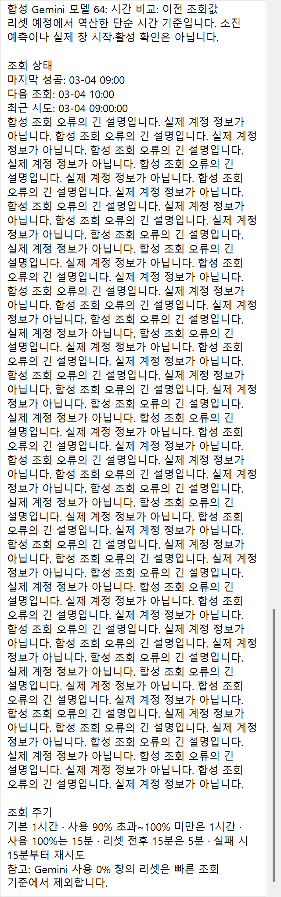
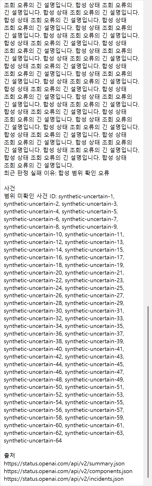

# #133 통합 Windows 상세 팝업 추가 확인 (2026-11-09)

**결론: Windows에서 처음부터 긴 팝업을 표시할 때 마지막 문장이 스크롤 범위 밖으로 잘리는 문제가 남아 있습니다. 병합 보류를 권고합니다.** 이번 지시는 추가 확인이므로 제품 코드를 수정하지 않았습니다. 실제 폭을 확인하는 실패 회귀 검사·합성 근거만 추가합니다. 버전·공통 판정·Mac·배포 EXE·운영 등록·사이트는 변경하지 않습니다.

## 기준과 변경 범위

- #133 병합: `72625030e895c57a37fd4e1fb27d8165aea672d1`.
- `f6b01b6 → 7262503` diff는 **MACOS_PORT.md, Mac/MacDetailTip.cs, Mac/MacDetailTipSmoke.cs, Mac/README.md** 네 파일뿐입니다. 공통·Windows·패키지·버전 변경은 없습니다.
- Windows 추가 검사는 `StatusToolTipUiChecks.cs`·`QuotaToolTipUiChecks.cs` 두 파일뿐입니다. 일반 빌드와 공통 검사는 유지됩니다.
- 최초 휠 검사 코드: `5fb794736de192797864a6363895f2741b402d81`. 끝줄의 실제 렌더 폭 검사까지 보강한 코드: `9da51d4068fad379b8d5dbc778725b6897040742`. 이후 커밋은 기록·합성 이미지뿐입니다.

## 실제 메시지로 통과한 항목

Windows 192 DPI(200%)에서 테스트 프로세스 소유 팝업 HWND에 `PostMessageW(WM_MOUSEWHEEL)`를 보내 실제 WinForms 큐·입력 필터·WndProc를 거쳤습니다. 이 검사에서는 스크롤 위치 속성을 직접 설정하지 않았습니다. OS의 실제 포인터를 옮기거나 물리 마우스 입력을 주입하지 않습니다.

| 합성 상세 | 저장된 내용 높이 | 팝업 높이 / 작업 영역 | 총 휠 메시지 | 저장 범위의 하단 offset |
|---|---:|---:|---:|---:|
| 상태: 긴 조회 오류 + 범위 미확인 ID 64개 | 5,555px | 2,032 / 2,064px | 33 | 3,523px |
| 한도: Gemini 창 64개 + 긴 조회 오류 | 6,449px | 2,032 / 2,064px | 40 | 4,417px |

총 메시지 수에는 아래 방향·하단 제한·위 방향·하단 복귀 확인이 포함됩니다. 팝업과 owner가 유지되고 팝업이 활성화되지 않는지 확인했습니다.

스크롤바가 없는 상태·한도 팝업을 다른 카드와 겹치게 만든 뒤 다음을 통과했습니다.

- 실제 `WM_NCHITTEST`가 `HTTRANSPARENT`를 반환합니다.
- 실제 `WindowFromPoint`가 팝업 대신 아래 카드 HWND를 찾습니다.
- 아래 카드의 HWND로 보낸 `WM_MOUSEMOVE`가 기존 호버 경로와 상세 전환으로 이어집니다.
- `WM_LBUTTONDOWN/UP`가 아래 카드의 클릭을 정확히 한 번 전달합니다. 상태 카드의 기존 Claude 공식 페이지 요청 이벤트도 한 번 발생합니다(외부 브라우저 대신 가짜 수신 목록).

프레임워크의 메시지 경로는 [WinForms 10 Control.cs](https://github.com/dotnet/winforms/blob/release/10.0/src/System.Windows.Forms/System/Windows/Forms/Control.cs)의 WmMouseWheel·WmMouseMove·WmMouseUp을 참고했습니다.

## 끝줄 누락 재현 — 미수정

처음 검사는 **저장된** ContentSize/스크롤 범위 끝에 도달했는지만 보았습니다. 1,164건이 통과했지만 캡처에 마지막 안내 문장이 없어 실제 표시 폭으로 다시 검사했습니다. 따라서 이 최초 통과를 전체 문장 접근 보장으로 취급하지 않습니다.

같은 합성 Gemini 64창·긴 오류를 쓰는 **실제 smoke fixture**를 격리된 renderer host에서 호출한 결과입니다. 운영 앱의 시작·종료·조회·DB·등록은 거치지 않습니다.

| 실제 렌더 측정 | 값 |
|---|---:|
| 저장된 측정 폭 | 640px |
| 표시 후 스크롤바를 뺀 실제 ClientSize.Width | 606px |
| 저장된 내용 높이 / 실제 폭으로 필요한 높이 | 6,449 / 6,513px |
| 부족한 스크롤 높이 | **64px (32 DIP)** |

실패 검사: `quota/Gemini-64-long-error scroll range includes the final line at the actual scrollbar-reduced client width`.

별도 새 팝업의 단순 합성 64행에서도 저장 높이 3,672px / 필요 높이 3,735px으로 63px 부족했습니다. 두 검사 모두 실제 화면 graphics의 DPI는 192였습니다. PNG 저장이나 DPI가 다른 bitmap의 측정만으로 생긴 현상이 아닙니다.

원인은 `QuotaDetailPopup.Display`가 첫 `Show` 전에 본문을 측정하는 동안 아직 native 스크롤바 폭이 반영되지 않아 640px을 사용하고, 표시 후에는 606px로 줄었는데 높이를 다시 계산하지 않는 순서입니다. 기존 팝업 핸들이 이미 있는 경우와 달리 새 팝업의 첫 긴 상세에서 재현됩니다. 상태와 한도는 이 Windows 팝업 클래스를 공유합니다. 확인한 실제 64창 실패 fixture는 한도 경로이며 상태의 모든 첫 표시 조합까지 별도로 단정하지 않습니다.

## 검사 결과·근거

- 최종 보강 코드 `build.ps1`: SDK 10.0.403, 경고 0·오류 0.
- `--self-test` **293,027건 통과**, Shared.Tests **291,898건 통과**, 기존 권한 제한 symlink fixture 1건 제외.
- 실제 휠·hit-test·호버·클릭 검사: 통과. 초기 전체 smoke **1,164 PASS·59 PNG·종료 코드 0**.
- 실제 폭을 확인하는 보강된 native smoke fixture: **실패·종료 코드 1**, 위 64px 누락 재현. 알려진 실패가 확인돼 전체 트레이 smoke를 다시 띄워 반복하지 않았습니다.
- 기본 상태/한도 화면 PNG는 #131 통합 Windows 기준과 파일 해시가 같습니다.
- 실제 OS 알림·운영 등록·사이트 송신은 0회입니다. 반복 트레이 기록 증가는 smoke 1회라 미평가입니다. 기존 2.9.0의 외부 재실행 완료는 사용자 확인입니다.
- 로그: `artifacts/detail-wheel-final133/`, `artifacts/detail-wheel-final133-strict/`. 격리된 renderer/focused native fixture 결과는 저장소 밖 `diagnostics/detail-renderer-probe-20261109/`에 있습니다. 실제 계정 값은 사용하지 않았습니다.

### 휠로 저장 범위 끝까지 내린 합성 캡처

모든 상태·창·사용률·오류·시각·ID는 합성입니다. 한도 캡처에서는 마지막 공통 CLI 안내가 잘리는 문제도 보입니다.

| 한도 Gemini 64창 + 긴 오류 | 상태 긴 오류 + 합성 ID |
|---|---|
|  |  |

## 메인에서 정할 것

추천은 #130에서 **실제 스크롤바 포함 client 폭이 확정된 뒤 높이를 다시 측정하는 Windows 보정**을 추가하는 것입니다. 이 회귀 검사를 통과한 뒤 전체 smoke를 다시 확인해야 합니다. 공통 판정·문구·320 DIP 폭·Mac 동작을 바꾸는 제안은 아닙니다.

이번에는 제품 보정을 하지 않으며 기존 Ready 플래그도 임의로 바꾸지 않습니다. PR 코멘트에 추가 검증 불합격과 병합 보류 권고를 명시합니다. 수정 범위·병합은 메인 결정 후 진행합니다.
