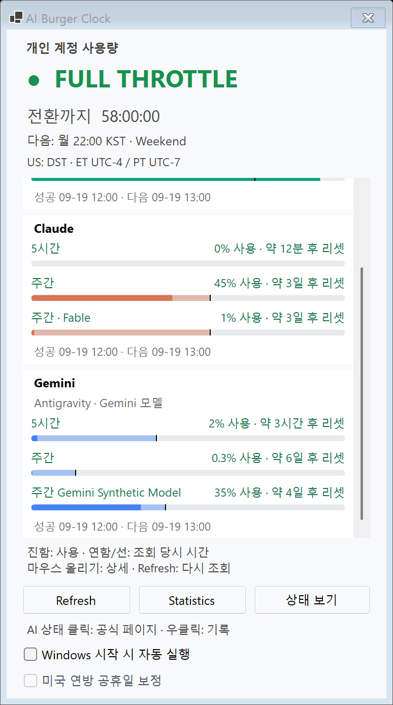
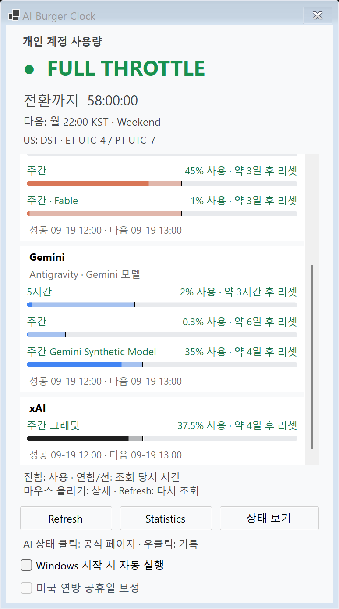
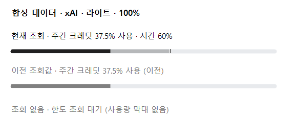
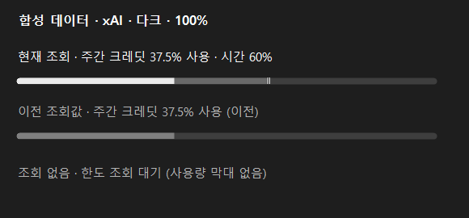
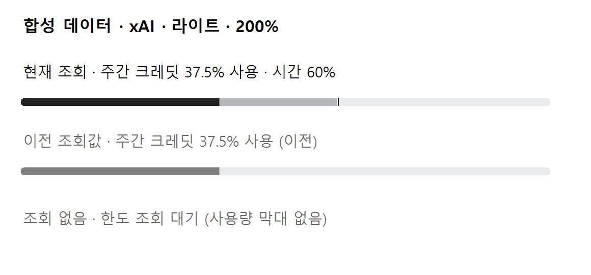
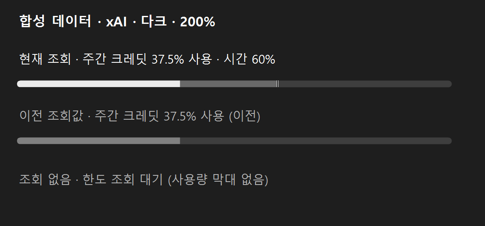

# xAI 주간 크레딧 · PR A (공통 + Windows, 개발 중)

버전은 2.8.9를 유지합니다. 배포 EXE·운영 실행·등록·Mac 전용 파일은 변경하지 않습니다.
Mac 전환은 A 브랜치를 대상으로 한 종속 PR B에서 진행합니다.
순서는 **B → A 반영 → 최종 HEAD 양쪽 확인 → A main 병합 → v1/v2 사이트 배포 → 앱 배포**입니다.
사이트는 별도 체크아웃에서 준비·합성 비교까지만 수행하며 이번 작업에서 배포하지 않습니다.

## 조회 계약과 개인정보

- 공식 native CLI를 절대 경로로 실행합니다. 고정 인자는 `--no-auto-update agent --no-leader stdio`입니다.
  공식 [Headless and Scripting](https://docs.x.ai/build/cli/headless-scripting)의 자동 업데이트 방지 안내를 사용합니다.
- JSON-RPC 2.0/ACP `initialize(protocolVersion=1)` → `authenticate(methodId=cached_token,
  _meta.headless=true)` → `_x.ai/billing`만 요청합니다. headless 인증 메타데이터도 같은 공식 문서의 예제를 따릅니다.
  파일/터미널 capability는 false이며 모델·세션 생성·프롬프트·재로그인·API 키 fallback 요청은 없습니다.
- CLI 내부의 캐시 토큰 갱신은 이용하되 실패/재로그인 요구는 조회 실패입니다. 앱이 인증 파일을 직접 읽거나
  토큰을 저장하지 않습니다. 자식 프로세스에서 Grok 파일/디버그 로그 환경변수를 제거하고 stderr를 버립니다.
- 클라이언트와 모니터 모두 xAI만 45초 제한입니다. 다른 Provider의 30초/40초 제한은 유지합니다.
  성공 후 stdin을 닫고 정상 종료를 기다립니다. 시간 초과·취소·오류 정리는 기존과 같이 이 호출의 PID와 자식 트리만
  대상으로 하며 프로세스 이름으로 다른 Grok/ai-chatroom 프로세스를 종료하지 않습니다.
- 출력 행/전체 크기는 기존 CLI 제한을 재사용합니다. 잘못된 JSON·버전/ID/순서·서버 요청·오류 응답은 실패입니다.
  알림 payload와 CLI 오류 문자열을 UI/로그로 전달하지 않습니다. 알 수 없는 데이터 필드는 무시합니다.

## 정규화와 화면

| 응답 | 정규화 |
|---|---|
| `config.creditUsagePercent` | JSON number, 유한 0~100만 허용. 문자열·없음·null·범위 밖은 실패 |
| `config.currentPeriod.type` | `USAGE_PERIOD_TYPE_WEEKLY`만 허용 |
| `currentPeriod.start/end` | 시간대가 있는 시각. end-start가 `AccountQuotaParsers.GrokWeeklyWindowMinutes`와 정확히 같아야 함 |
| 위 기간 상수 | 10,080분. 한 곳에서 바꾸며 초/분 반올림이나 이름 기반 추정을 하지 않음 |
| 한도 박스/행 | xAI / 주간 크레딧, 고정 행 ID `grok:weekly-credits` |

월간/알 수 없는 유형, 인증 실패, 메서드 없음(-32601), CLI 없음, 시간 초과와 필드 오류는 0%가 아닌 실패입니다.
이전 성공값이 있으면 기존처럼 이전 값으로 유지합니다. 요금제·잔액·계정 ID·원본 응답은 정규화/캐시/송신에 넣지 않습니다.
박스 순서는 ChatGPT → Claude → Gemini → xAI입니다. 상태 카드의 기존 사용량 보기 링크는 유지합니다.

공통 시간 비교는 마지막 성공 시각에 고정하며 사용률 0%인 주간 창도 표시합니다. 이전 값·경과 리셋 등 숨김 조건,
행 이름/값 분리·중간 생략·접근성 문장은 기존 규칙을 재사용합니다.
Windows xAI 현재 막대는 라이트 #202020, 다크 #EBEBEB이며 이전 값은 기존 #808080을 유지합니다.
조회 없음에는 막대/숫자를 만들지 않습니다. 합성 PNG에서 현재/이전/없음을 나란히 비교하며
명도 대비 3:1 이상, 시간층 1.5:1·경계선 3:1 목표를 검사합니다. Mac 색은 B에서 연결합니다.

## 예약·알림·저장

- 기본 1시간, 90% 초과~100% 미만 1시간, 소진 15분, 실패 재시도 15/30/60분은 공통 규칙입니다.
  리셋 구간/진입을 포함한 xAI 예약만 최소 10분이며 구간 밖의 빠른 꼬리 조회는 만들지 않습니다.
  시작·Refresh·절전 복귀·네트워크 조회의 기존 즉시 실행 경로는 바꾸지 않습니다.
- 기존 회복·주간 조기 초기화·대기 알림 재확인 규칙에 xAI를 포함합니다. 첫 등장에는 기준만 설정하고,
  기존 설정이 ON이면 이후 xAI에도 적용합니다. 기본 OFF·문구·알림 간격·대기열·결합 규칙은 유지합니다.
- `Xai`를 enum 끝에 추가해 기존 숫자 0/1/2를 보존합니다. DB schema 2와 캐시 v1 형식은 그대로이며
  새 캐시 키 `AccountQuota.v1.Xai`만 추가됩니다. 기존 DB/캐시를 이관하거나 복원하지 않습니다.
- 구버전이 새 Provider/종류 조합을 읽지 못하므로 아래 새 파일만 씁니다. 옛 파일은 읽기·이관·추가쓰기·삭제하지 않습니다.
  - `logs/quota-polling-diagnostics-v2.json` (Version=2)
  - `logs/quota-early-reset-decisions-v2.jsonl`
  - Windows `logs/notification-delivery-v3.jsonl`
  각 파일은 기존 256건/128KiB 제한과 원문/본문/계정 값 제외 규칙을 유지합니다.

## 모바일 사이트 반영 필요

[Windows 송신 계약](WINDOWS_QUOTA_EXPORT.md)의 wire schemaVersion을 2로 올려 정확히 네 Provider를 보냅니다.
사이트는 v1의 Codex/Claude/Gemini 세 개와 v2의 네 개를 모두 받아야 합니다. D1 테이블·인증 경계·seq/sourceId·하트비트·상한은 유지합니다.
xAI 박스의 한 행/막대/시간층/성공·다음 시각을 연결하며 기존 링크는 유지합니다. 계정 값·사이트 주소는 공개하지 않습니다.
사이트 배포 전에는 하단 기준 커밋을 A의 실제 병합 커밋으로 맞추고, 앱 배포보다 먼저 v1/v2 수신기를 배포합니다.

## 검증과 미확인

2026-11-09, .NET SDK 10.0.403에서 확인했습니다. 코드 검증 HEAD는
`51c8b183468e09a1eec1af9be9beca993d6c75ac`이며 이후 커밋은 결과 문서와 합성 PNG만 추가합니다.

| 항목 | 결과 |
|---|---|
| `build.ps1 -ReportGroup grok-weekly-quota` | 경고 0 / 오류 0, self-test 292,876 assertions PASS (기준 292,215 대비 +661) |
| `Shared.Tests` | 291,755 assertions PASS. 이 Windows 임시 파일시스템의 기존 symlink fixture 1건은 권한 제한으로 SKIP |
| 고정 before / after 슬롯 native smoke | 990 → 1,012 PASS, 실제 종료 코드 모두 0. PNG 45 → 49장 |
| 기존 상태 화면 픽셀 비교 | 시간표·공휴일·장애·범위 미확인·작은/큰 작업 영역 숨김/재열기 13/13 동일 |
| xAI 합성 팔레트 | 라이트/다크, 100%/200% 현재 값·이전 값 대비 3:1 이상, 조회 없음에 막대 없음 |
| 사이트 준비본 (배포하지 않음) | 합성 검사 82 PASS, typecheck/build/Worker 검증 PASS, C# 표시·시간 비교 기준 240/240 일치 |

Windows 결과는 `artifacts/grok-weekly-quota/`에 보관합니다. smoke는 각 슬롯 1회이므로
트레이 기록의 반복 실행 무증가는 이번 결과로 주장하지 않습니다. native 토스트 제출·등록 명령과
실제 계정 CLI·사이트 전송은 실행하지 않았습니다. 기존 배포 EXE·사용자 DB는 교체/변경하지 않았습니다.

공통 검사는 정상/0%/100%, 모든 실패 판정, headless·고정 RPC·취소·크기 제한, 경로, 10분 경계,
이전 값/없음, 캐시·진단 구버전 보존, 회복/조기 초기화·중복을 포함합니다. OS 알림과 실제 사이트 요청은 가짜 발송기만 씁니다.
사이트는 합성 API v1/v2와 C# 기준 표시/시간 비교를 검증합니다. 실제 계정 값/화면은 예시로 사용하지 않습니다.

## 합성 화면

모든 수치·시각·모델명은 합성 검사 fixture입니다. 기존 크기 안에서 xAI 박스 하나가 추가되며 한도 영역만 스크롤합니다.

| 200% 변경 전 | 200% 변경 후 (하단으로 스크롤) |
|---|---|
|  |  |

현재 값은 라이트의 짙은 무채색 / 다크의 밝은 무채색, 이전 값은 기존 회색입니다. 조회 없음은 막대 없이 문구만 표시합니다.

| 라이트 100% | 다크 100% |
|---|---|
|  |  |

| 라이트 200% | 다크 200% |
|---|---|
|  |  |

## Mac PR B 확인 항목

Mac B 확인: 공통 검사 건수/환경별 skip 설명, `Mac/build.sh`, native smoke, Finder PATH의 Grok 탐색,
네 박스/기존 fixture 대비 막대 +1, 라이트·다크 색/시간층/경계선, 팝오버 높이·스크롤·VoiceOver,
xAI 알림/진단 경로를 확인합니다. 기본 7막대 fixture는 8개가 되고 모델 전용 행 fixture도 하나 늘어납니다.
임시 사본 빌드·native smoke 횟수/LaunchServices 정리는 기존 Mac 작업 규칙을 따릅니다.
실제 OS 화면·종료 강제 정리·토큰 만료를 새 앱에 연결한 검증과 Mac 전환은 이 Windows 작업에서 대신 확인했다고 하지 않습니다.
