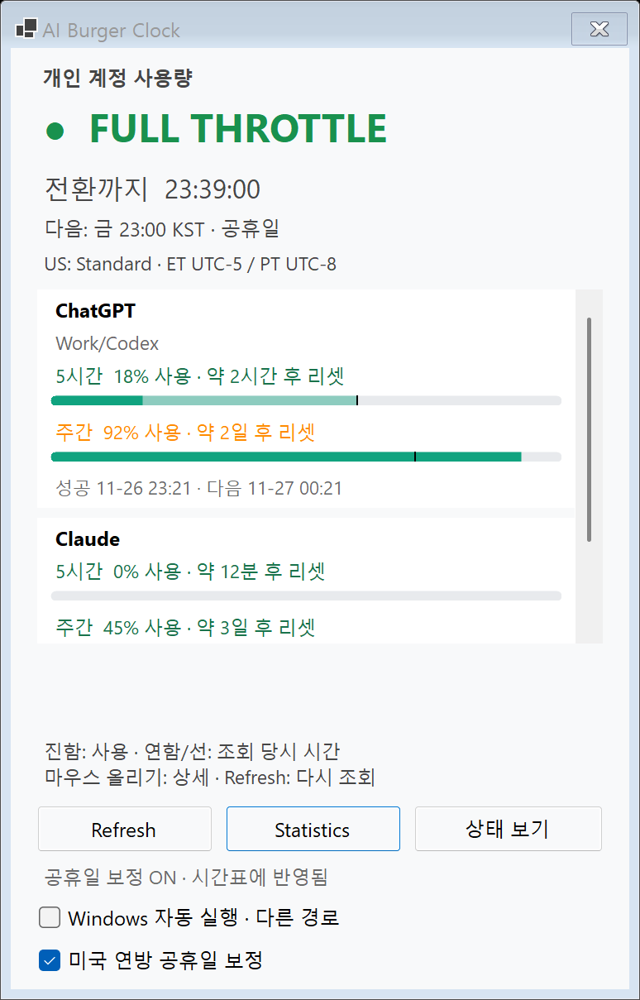
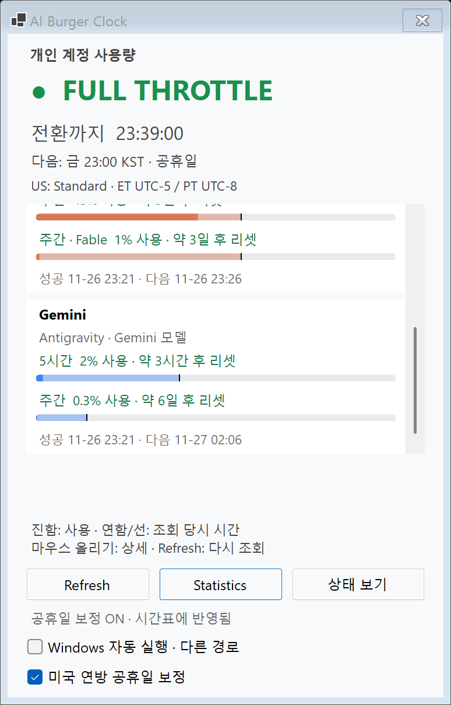
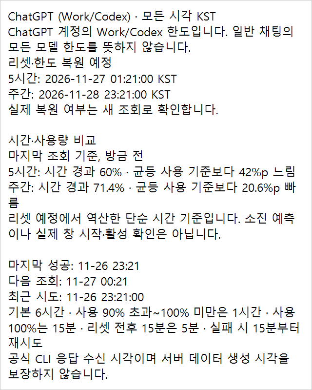

# AI Burger Clock 2.5.0 — Windows 한도 시간 비교 배포

기록일: **2026-10-15 KST**. 상태: **#54 승인·main 병합·백업·2.5.0 교체·최종 검사 완료 / 최종 화면·Refresh 정상 사용자 확인 / 새 배포본 실행 중**.

#52가 병합된 main `9716a1c7c0559f6128c5f384756179f0367fed01`에서 `git pull --ff-only` 후 `feature/windows-release-2-5-0`을 만들었다. #54는 **Windows만 변경(버전·기록·합성 PNG)**이며 제품·검사 C#와 공통 원본·Mac 파일은 다시 고치지 않았다. 사용자 승인 뒤 #54 Draft를 해제·병합하고 main을 fast-forward했다. **현재 dist는 병합 main `af1c831e70f0a956804255771a434f8103e1f5ea`에서 publish한 2.5.0**이다. 준비 검사와 최종 배포 검사를 아래에서 구분한다.

공개 문구·예시·PNG는 모두 **합성 데이터**다. 실제 계정 요금제·사용률·리셋 시각·식별자·화면 캡처·CLI 원문·사용자 DB·원본 진단 로그는 공개하지 않는다.

## 버전과 2.4.1 이후 변경

Version **2.5.0**, AssemblyVersion·FileVersion **2.5.0.0**이다. 같은 막대에 시간 비교를 더하는 표시 기능이므로 둘째 자리를 올린다. Windows 11 x64 / WinForms / net10.0-windows / framework-dependent 단일 EXE와 .NET 10 Desktop Runtime x64 요구사항은 유지한다.

| 항목 | 2.4.1 이후 main의 Windows 관련 변경 |
|---|---|
| #52 막대 | 회색 track → 연한 Provider 시간층 → 기존 진한 사용층 → 최상단 시간 경계선. 사용량이 시간층을 덮어도 경계선이 보임 |
| 기준 시각 | 시간 비율과 사용량은 마지막 성공 CLI 응답 수신 시각에 고정. 화면을 열 때 자동 조회하지 않고 기준 나이만 갱신 |
| 비교 문구 | Provider 상세에 `균등 사용 기준보다 N%p 빠름/느림`과 `마지막 조회 기준, N분 전`. 리셋에서 역산한 단순 기준이며 실제 창 시작·소진 시각 예측이 아님 |
| 접근성 | 공통 `QuotaLine.ComparisonText`를 Windows 값 행·막대의 설명에 직접 연결. 다른 행/Provider 상세를 파싱하지 않으며 숨김은 null/빈 설명으로 정리 |
| 숨김 조건 | 이전 값·리셋 경과·기간/시각 미제공·잘못된 값·모순·5시간 창 사용 0%에서는 비교만 숨김. 주간 0%는 유효한 기간이 있으면 비교. 경과만으로 사용량을 초기화하지 않음 |
| 색·배치 | 합성색으로 연한 면 1.5:1 자체 목표·경계선 3:1 목표. 고대비 시스템색/경계선 fallback. 기존 높이·행 수·Provider 박스·한도↔상태 전환 유지 |
| #51 BACKLOG | 양쪽 성능 측정과 최적화 후보를 문서에만 기록. 성능 최적화·근무 시간표 가중치·요금제/CLI 경로·한도 회복 알림·7b/7c는 이번에 구현하지 않음 |

2.4.1 EXE 소스 `0d69a64` 이후 `8b2845a`는 이전 배포 결과 기록이고 #50은 Mac csproj·Mac README·MACOS_PORT만 바뀌었다. 이 둘을 Windows 신규 기능으로 세지 않는다. #52의 계산·문구·검사·합성 전후 화면은 [구현 기록](QUOTA_TIME_OVERLAY.md)에 있다.

#52는 [Mac 최신 HEAD 78e6666 확인](https://github.com/hydron75/ai-burger-clock/pull/52#issuecomment-6187337048)에서 SDK 10.0.401 / Xcode 27.0, 공통 **251,519건**, 빌드 경고 0·오류 0, native smoke **종료 코드 0**, 선택 필드 호환성·380×821pt 팝오버 유지를 확인한 뒤 병합됐다. Mac 시간층·VoiceOver 연결은 별도 후속이다. 이 결과를 이번 Windows 환경에서 새로 실행한 Mac 검사로 적지 않는다.

**#54와 후속 배포 기록에서 변경하지 않은 것:** 공통 원본 28개와 제품/검사 C#, CLI·파서·조회 정책·알림·네트워크·시간표·공휴일·SQLite schema 2·캐시 형식, `Mac/`·`MACOS_PORT.md`·Mac 버전·AGENTS.md·자동 시작 설정. dist EXE 교체는 승인 후 아래 절차로 수행했다.

## 변경 파일

기존 수정:

- `AiBurgerClock.csproj`: Version / AssemblyVersion / FileVersion 함께 변경.
- `README.md`, `CODE_GUIDE.md`, `BACKLOG.md`: 준비 결과와 승인 후 실제 2.5.0 배포를 구분하고 사용법·검사·기록 연결. #51 보류 후보와 원인 미확정 smoke 관찰 유지.
- `QUOTA_TIME_OVERLAY.md`: #52의 Mac 최종 확인·main 병합 상태만 갱신. 당시 Windows 검사와 Mac 후속 미구현은 구분.

신규:

- `MAINTENANCE_2_5_0.md`: 준비/최종 배포 기록·Git 기준점·실제 백업·교체/복원 방법.
- `docs/reviews/windows-release-2.5.0-20261015/`의 PNG 3개: 이번 smoke 1회차에서 복사한 합성 한도 2장·Provider 상세 1장. 실제 계정 화면이 아니다.

루트·Properties C# **76개(기능 40 + 검사·진단 35 + 명찰 1)**, Mac 호스트 7개, 공통 검사 입구 1개로 총 84개다. 이번 버전 PR이 C# 파일이나 직접 패키지를 추가한 것은 아니다.

## 빌드와 실제 자체 검사

.NET SDK **10.0.402**. 버전 변경/검증 코드 커밋은 **`41f56e9bbe479ca7ee903f06f8e2d8f2092ebee4`**다. `build.ps1`을 실제 실행해 **경고 0 / 오류 0**과 내장 self-test 통과를 확인했다. 이어 기존 dist 2.4.1과 후보 bin 2.5.0을 각각 `--self-test`로 실행해 **실제 ExitCode 모두 0**을 확인했다. `Start-Process -Wait -PassThru`의 ExitCode이며 `$LASTEXITCODE`로 대신하지 않았다.

| 검사 그룹 | 실제 dist 2.4.1 | 후보 2.5.0 | 차이 |
|---|---:|---:|---:|
| quota usage/countdown/provider detail | 74 | 146 | +72 |
| quota snapshot time/usage comparison | 없음 | 207 | +207 |
| 나머지 공통 검사 | 251,166 | 251,166 | 0 |
| **공통 합계** | **251,240** | **251,519** | **+279** |
| **Windows 전용** | **307** | **307** | **0** |
| **전체** | **251,547** | **251,826** | **+279** |

감소한 그룹은 없다. 증가분은 #52에 이미 포함된 검사이며 이번 버전 변경으로 추가된 검사가 아니다. main/#52 최종 self-test와 후보는 **증감 0**이다. Windows 307건은 자동 시작 229 + 트레이 표시/픽셀 44 + Windows CLI 경로 3 + 경고 로그 31이다. 공통 합계는 Windows SelfTest가 SharedTestSuite를 한 번 실행한 결과다. 이번에는 Shared.Tests를 따로 실행하지 않았다.

## smoke 5회와 합성 화면

기존 2.4.1은 조작 도구에 창·트레이 종료 메뉴가 노출되지 않아 사용자가 정상 종료했다. 실제 프로세스 부재를 확인한 뒤 후보 Release EXE의 `--smoke-test --report-directory`를 **정확히 5회 순차 실행**했다. 임시 DB·가짜 HTTP/CLI·실제 WinForms 메시지 루프를 사용하고 `--verify-autostart`는 실행하지 않았다. 실패 제외·자동 재시도·대기 시간 증가 없이 모든 회차를 남겼다.

| 회차 | 실제 ExitCode | PASS | FAIL | 소요 시간 |
|---|---:|---:|---:|---:|
| 1 | 0 | 492 | 0 | 32.39초 |
| 2 | 0 | 492 | 0 | 32.22초 |
| 3 | 0 | 492 | 0 | 32.29초 |
| 4 | 0 | 492 | 0 | 32.27초 |
| 5 | 0 | 492 | 0 | 32.15초 |
| **실패** | **0/5회** | | | |

- 기존 2.4.1 기록의 smoke 394건 대비 **+98건**(Windows 그리기/팔레트 83 + UI 연결/조회 불변/행별 접근성 15)이며 #52 최종 492건과 같다. 이번에 기존 dist smoke를 다시 실행한 것은 아니다.
- 상태·통계·공휴일·알림 요청·한도 전환·기록·메모 잘림·Provider 상세와 #52 시간층·경계선·행별 설명·기준 나이·숨김 조건이 통과했다. 실제 Windows 스크린리더/OS 테마·DPI 변경 실기와 합성 검사 결과는 구분한다.
- 합성 Gemini 10초 지연은 **10.02~10.05초**, UI heartbeat **매회 49회**, 트레이·상태 카운트다운 **각각 11~12종**이었다. 대기 중 메뉴·창·다른 Provider가 응답했다. BalloonTipShown **매회 19회**는 native 이벤트이며 실제 배너의 시각적 전달 확인은 아니다.
- #52 최신 검증 PNG와 회차별 20개를 비교했다. **1·2·4회는 20개 전부 SHA-256 동일**, 3·5회는 각각 **19개 동일**이다. 두 차이는 `account-quotas-exhausted.png`의 **Refresh 버튼 영역 2,197픽셀(x46~255, y975~1028)**에만 있다. 두 회에서는 버튼이 비활성 회색, 기준/다른 회에서는 활성 상태다. 한도 막대·시간층·경계선·행 문구·Tooltip·나머지 픽셀은 동일하며 layout JSON은 **매회 14개 모두 동일**하다.
- 기존 `DIAG:`를 확인했다. 3·5회 `Resume`의 한도 조회 완료 시점에도 `monitor-status/all`이 진행 중이고 `Refresh.Enabled=false`였다가 각각 약 **80ms / 53ms** 뒤 true로 바뀌었다. 현재 코드는 공식 상태 조회 중 Refresh를 비활성화하며, 이 렌더 직전 검사는 한도 조회 완료만 기다린다. 이는 촬영 시점의 기존 비동기 상태 차이이며 후보는 버전 외 C#가 main과 같다. 이미지를 같게 만들기 위해 코드를 바꾸거나 대기를 늘리지 않았다.
- 첫 회의 한도/Provider 상세 PNG를 직접 열어 연한 시간층·최상단 경계선·비교 문구·고정 폭 줄바꿈을 확인했다. 상태 창 PNG **774×1209**, 클라이언트 **748×1138** 픽셀과 기존 한도 값 행/막대 수를 유지한다. 2.4.1과의 의도한 내부 표시 차이는 #52 구현 기록에서 별도로 설명한다.
- 원인 미확정인 초기 뜻밖의 한도 모드 관찰과 SmokeDiagnostics는 유지한다. 이번 0/5회가 초기 원인을 확정하거나 모든 간헐 실패를 해결했다는 보장은 아니다. stderr에는 정상 DIAG도 있어 파일이 비었다고 적지 않는다.

## 실제 계정 화면 확인

후보 **2.5.0.0**을 일반 실행해 기존 공식 CLI 로그인과 앱 데이터를 사용하도록 했다. 프로세스 응답은 정상이다. 정상 시작 조회는 계정 한도 캐시를 갱신할 수 있으므로 사용자 DB 전체가 무변경이었다고 주장하지 않는다. 인증 파일·토큰/쿠키 직접 조회·로그인 변경·설치·리셋권 사용·설정 변경은 하지 않는다.

**확인 상태: 정상 — 사용자 확인.** 이 환경의 조작 도구에는 실제 앱 창이 노출되지 않아 새 조회 성공 뒤 비교 가능한 한도의 시간층·경계선·Provider 비교 문구/나이 정상 여부를 사용자에게 요청했고 **정상**으로 확인받았다. 5시간 0%·이전 값·기간 미제공 등의 비교 숨김은 정상 조건으로 안내했다. 실제 값이나 계정 화면 캡처는 받거나 게시하지 않았다. 합성 렌더나 프로세스 응답만으로 실제 화면을 자동 관찰했다고 적지 않는다.

사용자가 테스트 앱을 정상 종료한 뒤 프로세스 부재를 확인하고 같은 기존 **2.4.1 dist를 `--autostart`로 다시 실행**했다. 앱 한 개·기존 dist 실행 경로·`Responding=True`, FileVersion **2.4.1.0**와 SHA-256 불변을 확인했다. HKCU Run·StartupApproved 종류/값도 준비 전과 동일하다. 이는 기존 배포본을 다시 실행한 것이며 2.5.0 배포 교체나 롤백을 실행한 것이 아니다.

## Git 기준점과 실행 파일

| 기준 | 전체 커밋 해시 / 상태 |
|---|---|
| 기존 배포 2.4.1 EXE 소스 | `0d69a64f5cb337be57add9be1036fca923330d4f` |
| #51 BACKLOG main 병합 | `8dee13abc4e5ed225ec723855cdf15738f75ed55` |
| #52 최종 HEAD / Mac 확인 | `78e66663480a0a4847d7e04426cb44093bd8fa58` |
| #52 main 병합 / 이번 준비 브랜치 출발점 | `9716a1c7c0559f6128c5f384756179f0367fed01` |
| 버전 변경 / 실제 검증 코드 | `41f56e9bbe479ca7ee903f06f8e2d8f2092ebee4` |
| #54 승인·병합 대상 HEAD | `c6768a7bcf93c4353f3f5137710147875ff91b2a` — 41f56e9 뒤 Markdown·합성 PNG만 변경 |
| #54 main 병합 / 최종 배포 EXE 소스 | **`af1c831e70f0a956804255771a434f8103e1f5ea`** |
| 최종 EXE 생성 뒤 변경 | 배포 결과를 적는 Markdown만 변경. 후속 문서 커밋을 EXE 소스로 적거나 다시 publish하지 않음 |

| 항목 | 교체된 기존 2.4.1 | 준비 2.5.0 bin apphost |
|---|---|---|
| 경로 | 백업의 `replaced-2.4.1.exe` | 준비 당시 `bin/Release/net10.0-windows/win-x64/AI Burger Clock.exe` |
| FileVersion | `2.4.1.0` | `2.5.0.0` |
| ProductVersion | `2.4.1+0d69a64f5cb337be57add9be1036fca923330d4f` | `2.5.0+41f56e9bbe479ca7ee903f06f8e2d8f2092ebee4` |
| 크기 | **3,392,747 bytes** | **163,328 bytes** |
| SHA-256 | `E610CD39DB17EBDC48EC7A6E0349B2A2B2993DEBE4DE555E41F6E1C10FE104D1` | `1061DF345CA15834A2B8DC7CB013E5A21B09FBAB9D7B0CC078C20F59B5E9C52A` |

bin의 EXE는 주변 DLL이 필요한 apphost로 **최종 배포 단일 EXE가 아니다.** 이를 dist에 복사하지 않고 승인 뒤 병합 main에서 publish했다.

| 항목 | 최종 배포 2.5.0 |
|---|---|
| 경로 | `dist/win-x64/AI Burger Clock.exe` |
| FileVersion | **`2.5.0.0`** |
| ProductVersion | **`2.5.0+af1c831e70f0a956804255771a434f8103e1f5ea`** |
| 크기 | **3,450,091 bytes** |
| SHA-256 | **`42EBF164BAB599B49D20CCB2E7DADB8A8A5FAE2395094770D00EBC4AF8ACB4E9`** |

최종 EXE의 절대 경로는 `C:/Users/mc_bl/.codex/.chatgpt-projects/g-p-6aa5eb198fd88191b7382af0eb114af4/AiBurgerClock/dist/win-x64/AI Burger Clock.exe`다.

## 실제 백업·교체와 최종 검증

시작 전에 Refresh PNG 차이는 **기존 공식 상태 조회가 진행 중인 캡처 타이밍 차이이며 앱 동작 변화가 아니다**라고 결론을 알렸다. 진단상 한도 조회 완료 뒤에도 공식 상태 조회가 진행 중인 두 회에서만 버튼이 잠시 비활성화됐고, 각각 약 80ms / 53ms 뒤 활성화됐다. #54에는 버전 외 제품·검사 C# 변경이 없다. 이 근거로 사용자 승인 조건을 충족한 뒤 진행했다.

1. #54 Draft를 해제하고 승인 HEAD `c6768a7`을 지정해 병합했다. main에서 `git pull --ff-only` 후 **`af1c831`와 깨끗한 작업 트리**를 확인했다. 승인 HEAD와 병합 main의 제품·검사 C#/공통/Mac 내용은 동일했다.
2. 기존 2.4.1의 트레이 종료 메뉴가 조작 도구에 노출되지 않아 **사용자가 정상 종료**했다. 실제 앱 프로세스 0개, DB 존재, `%LOCALAPPDATA%/AIBurgerClock/burgerclock.db-wal`·`-shm` 부재를 확인했다. 강제 종료·WAL 삭제·DB 내용 조회는 하지 않았다.
3. **18:41:37 KST**: 새 폴더 **`../backups/release-2.5.0-20261015/`**에 기존 EXE·dist ZIP·실제 2.4.1 EXE 소스의 git archive ZIP·닫힌 DB를 보관했다. 원본/복사본 및 ZIP 안 EXE의 해시를 검증했다. 백업 중 프로세스/WAL 부재와 DB 해시 불변을 재확인했으며 기존 백업은 덮어쓰지 않았다.
4. 승인된 **병합 main에서 `build.ps1 -Publish`**를 실행했다. SDK **10.0.402**, 빌드 **경고 0·오류 0**, publish 성공이다. 최종 단일 EXE의 **self-test 251,826건(공통 251,519 + Windows 307), 실제 ExitCode 0**을 확인했다. 준비 대비 증감 0, 기존 2.4.1 대비 +279다.
5. 최종 dist의 `--smoke-test --report-directory`를 **별도 1회** 실행해 **492 PASS / 실패 표시 0 / 실제 ExitCode 0 / 32.22초**를 확인했다. 준비 5회와 별도 결과다. 상태·통계·공휴일·트레이·한도 화면/시간층/경계선·Provider 상세·기록·Refresh 등의 기존 검사가 통과했다. 실제 사용자 화면의 시각적 확인과 합성 검사 통과는 구분한다.
6. **18:46:58 KST**: 최종 EXE를 백업의 `published-2.5.0.exe`에도 보관하고 dist와 해시 일치를 확인했다. publish와 격리 self-test/smoke가 끝날 때까지 사용자 DB 해시는 닫힌 백업 시점과 같고 WAL/SHM도 없었다. 이후 일반 실행은 정상 캐시를 갱신할 수 있으므로 배포 전체에서 DB 불변을 주장하지 않는다.
7. 자동 시작을 **읽기 전용**으로 전후 및 일반 실행 뒤 **18:52:54 KST**에 비교했다. HKCU Run `AI Burger Clock`은 **String**, 명령은 **동일한 절대 dist EXE 경로를 큰따옴표로 감싼 값 + `--autostart`**다. StartupApproved/Run은 **Binary / `020000000000000000000000`**으로 동일하다. 등록 경로의 실제 파일은 최종 2.5.0 버전·해시와 일치한다. 등록 쓰기·`--verify-autostart`·체크박스 조작은 하지 않았다. 실제 재부팅/재로그인 시험과는 별개다.
8. **18:47:35 KST**: 새 dist를 `--autostart`로 일반 실행했다. 앱 한 개·최종 dist 실행 경로·`Responding=True`·입력 대기 준비·최종 버전/해시를 확인했다. 조작 도구에는 실제 트레이·창이 노출되지 않아 사용자에게 최종 화면 확인을 요청했고, **트레이·상태 창·시간층/경계선/비교 문구·Refresh 조회 완료 뒤 버튼 재사용 모두 정상으로 확인**받았다. 준비 때의 정상 확인과 별도이며 실제 계정 값·캡처는 받거나 게시하지 않았다.

백업의 절대 경로는 `C:/Users/mc_bl/.codex/.chatgpt-projects/g-p-6aa5eb198fd88191b7382af0eb114af4/backups/release-2.5.0-20261015/`다.

| 보관 파일 | SHA-256 / 확인 |
|---|---|
| replaced-2.4.1.exe | `E610CD39DB17EBDC48EC7A6E0349B2A2B2993DEBE4DE555E41F6E1C10FE104D1` — 교체 전 원본 및 dist ZIP 안 EXE와 일치 |
| dist-2.4.1.zip | `4BB99BFAA16FCA6EEB9D8FCCAB8EA4B8889494FBAC430AFFE6AD8B09AB8C46CE` |
| source-2.4.1-0d69a64.zip | `C788BA93C39BE35EBC2A302DFBE17AA66DFD4B03D8B8A8542F73ADD3E9E2188E` — 기존 실제 EXE 소스의 git archive |
| burgerclock.db | 정상 종료 뒤 원본/복사본 해시 일치. DB·해시·원본 manifest는 로컬에만 보관하며 내용 조회 없음 |
| published-2.5.0.exe | `42EBF164BAB599B49D20CCB2E7DADB8A8A5FAE2395094770D00EBC4AF8ACB4E9` — 최종 dist와 일치 |

복원은 적용하지 않았다. 실제 2.4.1 복원 시험도 미수행이다.

## 승인받은 교체 계획 — 위 순서로 실행, 복원은 미적용

1. 사용자가 준비 PR 병합·교체를 승인하면 승인 HEAD를 지정해 병합하고 main에서 `git pull --ff-only`한다. 깨끗한 작업 트리와 병합 main 전체 해시를 **최종 EXE 소스**로 기록한다. 뒤의 문서 전용 커밋을 EXE 소스로 바꾸지 않는다.
2. 그 시점의 기존 앱을 **다시 정상 종료**하고 실제 앱 프로세스 0개와 `%LOCALAPPDATA%/AIBurgerClock/burgerclock.db-wal`·`-shm` 부재를 확인한다. 준비 검사 때의 종료로 대신하지 않는다. WAL/SHM이 남으면 삭제하거나 강제 덮어쓰지 않고 중단·원인을 확인한다.
3. 새 **`../backups/release-2.5.0-<교체일>/`** 폴더에 기존 dist ZIP, `replaced-2.4.1.exe`, 실제 2.4.1 EXE 소스 `0d69a64`의 git archive ZIP, 정상 종료된 DB를 보관한다. 같은 폴더가 이미 있으면 덮어쓰지 않는다. 원본/복사본·ZIP 안 EXE의 해시를 검증하고 백업 중 프로세스/WAL 부재를 재확인한다. DB·EXE·manifest·원본 로그는 로컬에만 둔다.
4. **병합된 main에서 `build.ps1 -Publish`**를 실행한다. 경고 0·오류 0과 최종 단일 EXE self-test의 실제 ExitCode 0, 최종 EXE의 별도 smoke·합성 화면을 확인한다. 새 단일 EXE도 같은 백업 폴더의 `published-2.5.0.exe`로 보관해 해시가 dist와 같은지 확인한다. 최종 소스 해시·EXE 경로·FileVersion·ProductVersion·크기·SHA-256과 실제 백업 경로를 이 문서에 기록한다.
5. 자동 시작 등록은 새로 쓰지 않고 **읽기 전용으로 전후 비교**한다. HKCU Run `AI Burger Clock`의 종류/값이 같은 큰따옴표 절대 dist 경로 + `--autostart`인지, StartupApproved/Run의 종류/값이 유지되는지 확인한다. 그 경로가 가리키는 실제 파일의 버전·해시가 새 2.5.0과 일치해야 한다. `--verify-autostart`·체크박스 조작은 실행하지 않는다.
6. 새 dist를 일반 실행하고 앱 한 개·실행 경로·응답·트레이·상태 창·한도 시간층/경계선/상세를 확인한다. 조작 도구가 실제 창을 제공하지 않으면 사용자에게 정상 여부만 확인받고 자동 관찰로 과장하지 않는다. 기존 DB·정상 캐시를 보존한다.
7. 문제가 있으면 아래 계획으로 2.4.1 EXE만 복원하고 결과를 알린다. 성공하면 README·CODE_GUIDE·BACKLOG의 준비 표시를 실제 배포 결과로 갱신한다.

준비 시작과 종료 때 읽기 전용으로 비교한 기존 HKCU Run은 **String**, 같은 절대 dist 경로 + `--autostart`이고 StartupApproved는 **Binary / `020000000000000000000000`**으로 동일하다. 이 값은 실행 환경별 관측이며 재부팅/로그인 자동 시작을 이번에 시험했다는 뜻은 아니다. 준비 종료의 배포 EXE도 기존 버전·해시 그대로다.

### 2.4.1로 되돌리기

새 앱을 정상 종료하고 프로세스·WAL/SHM 상태를 확인한다. 교체 이후의 현재 DB는 별도로 보존하며 WAL·로그·기록을 삭제하지 않는다. 새 release 백업의 `replaced-2.4.1.exe` 또는 기존 dist ZIP에서 **EXE만 원래 dist 경로로 복원**한다. FileVersion **2.4.1.0**, ProductVersion `2.4.1+0d69a64...`, 위 기존 SHA-256을 확인하고 `--autostart`로 실행한다. 같은 자동 시작 경로·등록 값과 트레이·창을 확인한다.

#52는 schema 2·한도 캐시/기록 형식을 바꾸지 않고 새 필드는 표시 모델에만 있다. 2.4.1로 돌아가면 시간층·경계선·비교 문구가 없어지는 것이 예상 차이다. 백업 DB를 자동으로 덮어써 새 기록을 잃게 하지 않는다. DB 복원이 별도로 필요하면 현재 데이터를 보존하고 범위·유실 위험을 설명한 뒤 승인받는다. **실제 복원 시험은 미수행**이다.

## 로컬 증거와 미수행

로컬 증거는 ignored `artifacts/release-2.5.0-preparation-20261015/`의 build.txt, dist-2.4.1-self-test.txt·errors, candidate-2.5.0-self-test.txt·errors, smoke/run-01~run-05의 stdout/stderr·PNG/layout, smoke-results.json과 preparation-baseline.json이다. 이 폴더의 진단 스크립트·원본 로그·개인 자료는 커밋하지 않는다.

- 최종 배포 증거는 ignored `artifacts/release-2.5.0-deployment-20261015/`의 publish-build.txt, final-self-test.txt·errors, final-smoke의 smoke.txt·smoke-errors.txt·render, backup-before.json·validation.json·completion.json에 있다. 백업 폴더에도 별도 manifest를 보관한다. 원본 로그·manifest·DB·EXE·개인 자료는 커밋하지 않는다.
- 완료: 준비 build/self-test·후보 smoke 5회·합성 렌더 비교·후보 실제 화면 사용자 확인, 승인 뒤 #54 병합·main 업데이트·정상 종료·WAL 검사·백업·publish 교체·최종 단일 EXE self-test·별도 smoke 1회·해시·자동 시작 등록 유지·새 2.5.0 일반 실행.
- 최종 배포본의 트레이·상태 창·한도 시간층/경계선/비교 문구·Refresh 동작은 **정상 — 사용자 확인**이다. 준비 때의 사용자 확인과 구분하며 자동 관찰로 적지 않는다.
- 실제 재부팅/재로그인 자동 시작·절전 복귀·전체 네트워크 단절/재연결·장시간 조회·배너의 시각적 노출·실제 OS 테마/고대비/DPI·다중 모니터·스크린리더 실기는 미수행이다. 기존 버전이나 합성 결과를 새 실기 통과로 옮겨 적지 않는다.
- 이번 Windows 준비·배포에서 Mac 빌드/native·별도 Shared.Tests·실제 공개 상태 probe/독립 계정 CLI probe는 따로 실행하지 않았다. 일반 실행의 정상 조회와 합성 검사를 구분한다. 실제 2.4.1 복원 시험은 미수행이며 복원도 적용하지 않았다.
- 현재 실행 중인 앱은 **최종 2.5.0 dist**다. 후속 문서 커밋은 이 EXE의 소스 `af1c831`과 구분하고 다시 publish하지 않는다.
