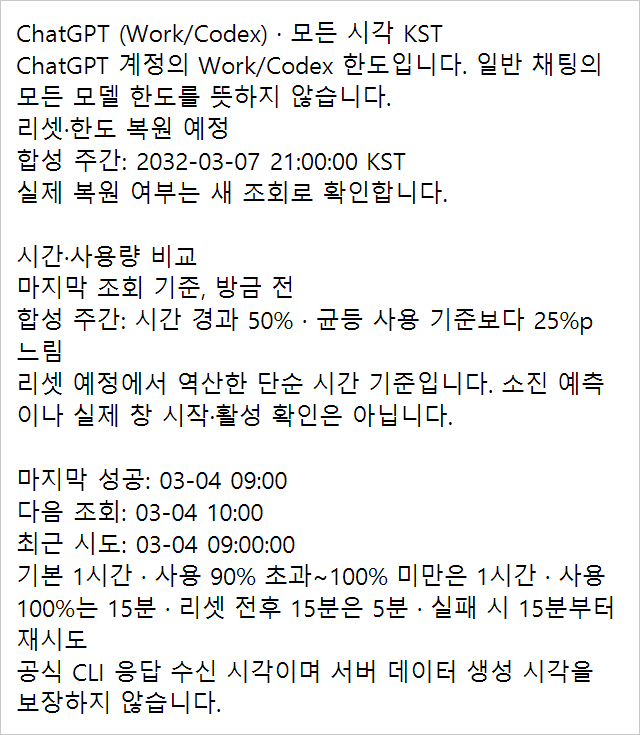
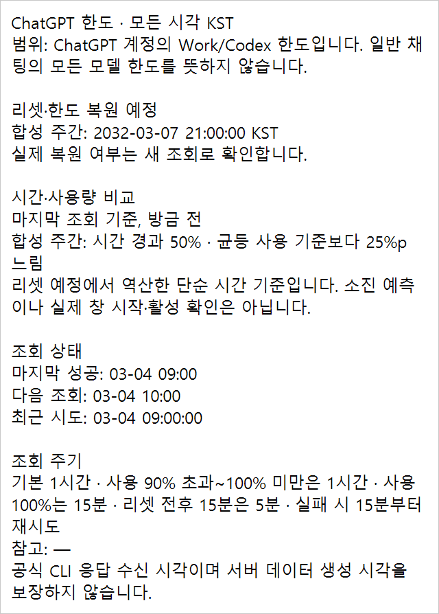
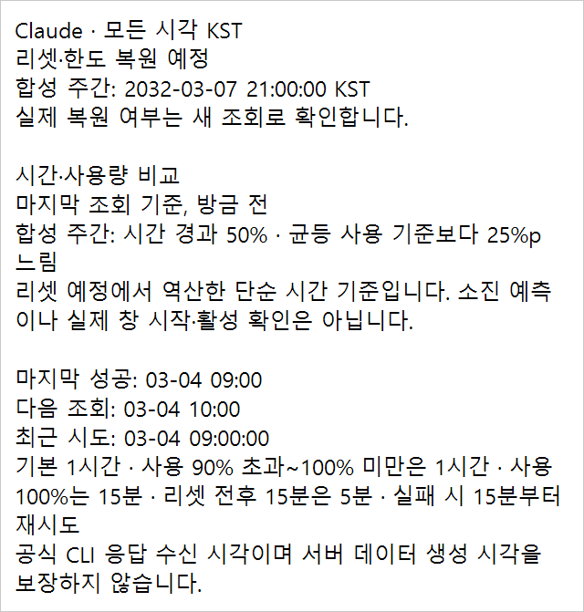
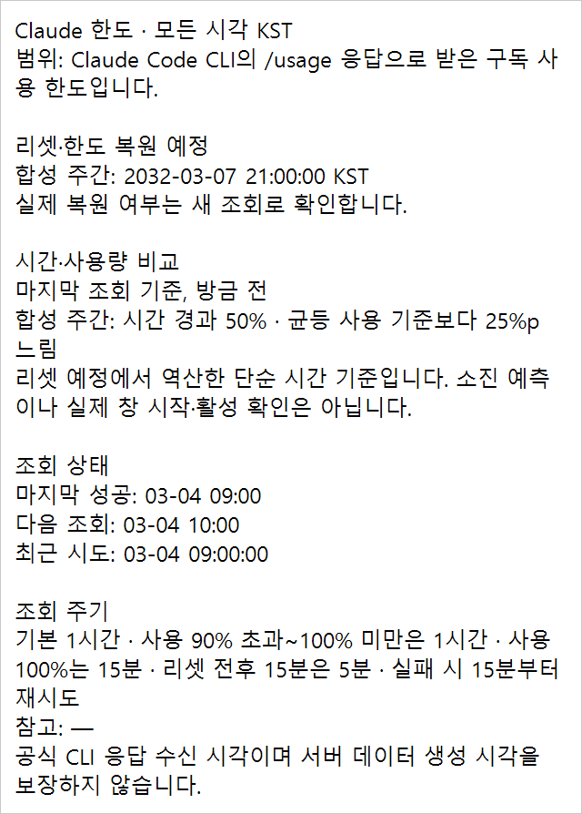
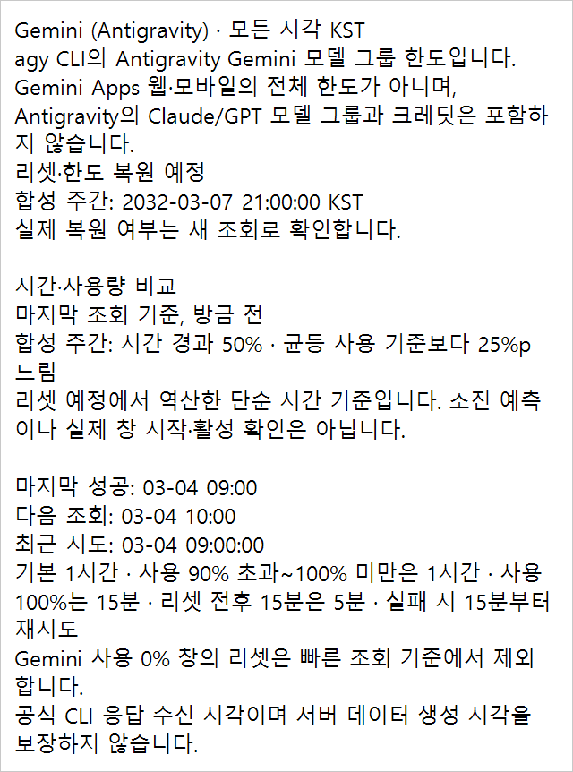
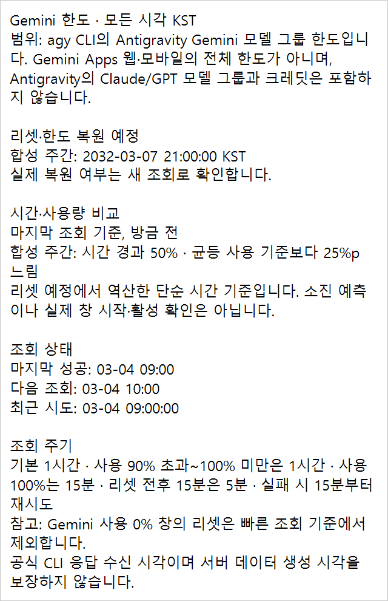
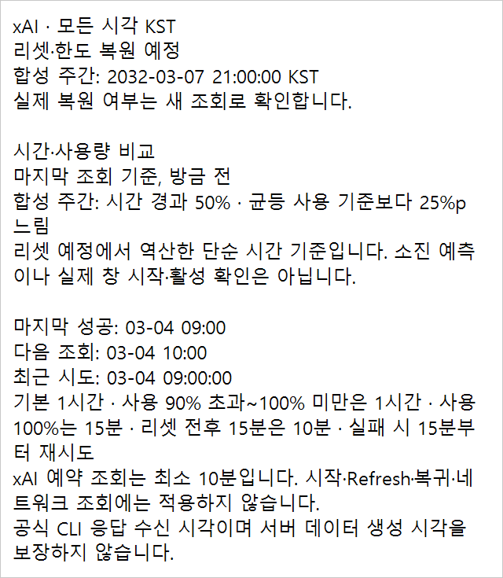
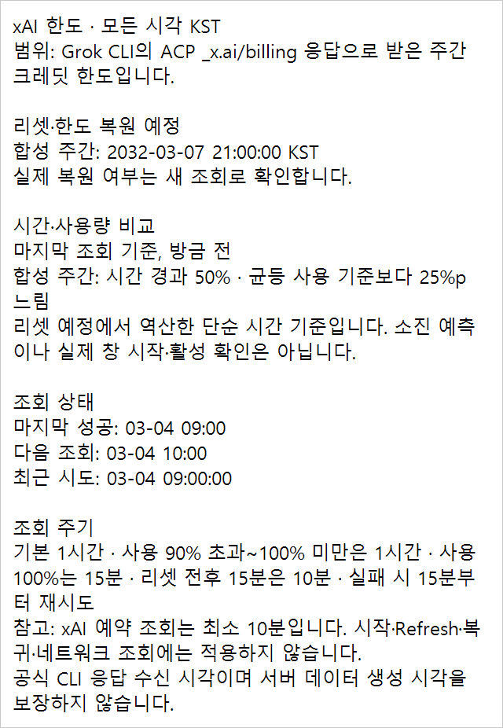

# 네 Provider 한도 상세 · 전후 합성 캡처

모든 수치·시각·창 이름은 가짜 시각 `2032-03-04T00:00:00Z`의 합성 데이터입니다. 실제 계정 화면·한도 값·인증 정보는 사용하지 않았습니다.

## 전후 화면 (실제 Windows 렌더링, 200%)

| Provider | 변경 전 | 변경 후 |
|---|---|---|
| ChatGPT |  |  |
| Claude |  |  |
| Gemini |  |  |
| xAI |  |  |

변경 전 제품 코드는 main `c9be3165f2b32924f941ee54793d53815eee5c24`이며, 캡처를 위해 합성 fixture와 네 Provider 팝업 검사만 추가한 빌드입니다. 변경 후 검증 코드 커밋은 `2e485f6f87a103ff2432460df649479e9972187e`입니다. 이후 커밋은 이 캡처·검증 기록만 추가합니다.

## 폭·높이 측정

| Provider (정상 합성 값) | 전 폭×높이(px) | 후 폭×높이(px) |
|---|---:|---:|
| ChatGPT | 640×735 | 640×894 |
| Claude | 640×671 | 640×894 |
| Gemini | 640×862 | 640×990 |
| xAI | 640×735 | 640×926 |

- 네 Provider × 정상/이전/조회 없음/오류 16상태 모두 전후 외곽 폭 640px = 320 DIP입니다. 높이는 범위 문장·본문 길이에 따릅니다.
- 실제 보고된 외곽 폭 차이는 이번 조건에서 재현되지 않았으며 원인을 확정하지 않았습니다. 기존 `MeasureDetail`·팝업의 320 DIP 계산과 화면 내 배치·스크롤 코드는 유지했습니다.
- 기존 실제 팝업 검사는 xAI를 빠뜨렸고 측정 함수의 긴 본문은 ChatGPT만 사용했습니다. 이번에는 16상태 각각을 96/144/192 DPI로 측정하고 native 192 DPI 팝업으로 확인합니다. 96/144 DPI는 오프스크린 측정이며 실제 해당 배율 데스크톱 캡처는 아닙니다.
- 긴 상세의 화면 내 스크롤·끝줄 도달, 긴→한 줄 상세 전환 시 같은 외곽 폭 복원도 검사했습니다. 화면 자체가 320 DIP보다 좁을 때는 기존 작업 영역 축소 규칙을 유지합니다.

## 검사 결과

- 변경 전 새 문구 검사가 `Codex/normal exact synthetic detail`에서 실패하는 것을 확인했습니다.
- 신규 공통 검사 72건: 16상태 전체 상세 골든·구역 순서·공유, Detail 외 전체 필드의 변경 전 합성 해시, 빈 창 목록, 기존 조기 초기화 기록 원문/위치.
- `build.ps1`: SDK 10.0.403, 경고 0·오류 0, self-test **292,948건**, 종료 코드 0.
- `Shared.Tests`: **291,827건**, 종료 코드 0. 기존 symlink fixture 1건은 권한 제한으로 제외했습니다.
- before smoke **1,028건·53 PNG**, after smoke **1,084건·53 PNG**, 모두 종료 코드 0. after의 추가 건수는 모든 상태의 DPI 측정과 스크롤 전환 검사입니다.
- 가짜 HTTP·CLI·자격 증명·알림 발송기만 사용했습니다. 실제 OS 토스트 제출·운영 등록·사이트 송신은 0회입니다. 트레이 기록의 반복 실행 증가 검사는 이번 단일 실행에서 평가하지 않았습니다.
- 로컬 로그: `artifacts/quota-detail-template/`. 변경 전 상세/해시와 red/green 집중 검사 자료는 저장소 밖 임시 `diagnostics/quota-detail-template-20261109/`에 보관하며 커밋하지 않았습니다.

## 미확인·후속

- Mac 공통 검사·빌드·native 상세의 고정 폭/긴 내용/VoiceOver 확인.
- 실제 계정 화면에서 보고된 폭 차이의 원인(이번 합성 16상태에서는 재현되지 않음).
- 운영 배포는 하지 않았습니다. 기존 2.9.0 EXE·등록·사이트는 그대로 유지합니다.

[공통 문구와 CLI 범위 근거](../../../QUOTA_PROVIDER_DETAILS.md)
