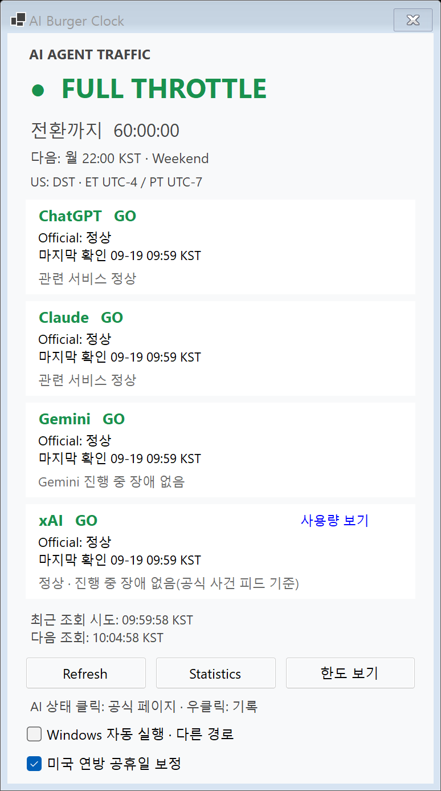
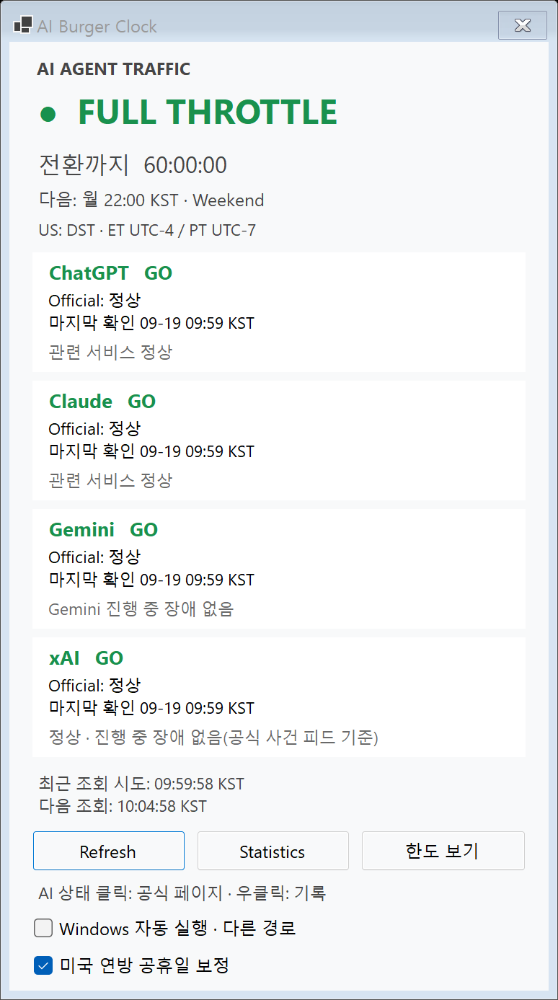

# xAI 사용량 링크 제거 · 합성 화면 비교

모든 화면은 smoke의 가짜 현재 시각·공식 상태 응답으로 만들었습니다. 실제 계정 화면이나 한도 값은 사용하지 않았습니다.

## Windows 전후 화면 (200%)

| 변경 전 | 변경 후 |
|---|---|
|  |  |

- 변경 전은 배포된 2.9.0과 같은 후보 소스 `3102e1646c9bf9fc0bf52a80fddc335787a37aab`, 변경 후 코드는 `1408717`입니다. 기준 main은 `1e04f42bb3333b520eebcc99459a3f7ff8857644`이며 두 기준의 상태 카드 구현은 같습니다.
- 네 카드 모두 342×83 DIP이며 세로 간격은 6 DIP입니다. 제목 영역도 모두 326×20 DIP로 맞췄습니다. 200%에서는 카드 684×166px, 간격 12px입니다.
- ChatGPT·Claude·Gemini 카드 영역은 전후 픽셀이 동일합니다. xAI는 사용량 링크를 없애고 제목 폭만 다른 카드와 같게 복원했습니다.
- `Refresh` 외곽선은 캡처 시 포커스 표시가 다릅니다. 화면 전체가 픽셀 단위로 같다는 의미는 아닙니다. 버튼 동작·조회 정책은 변경하지 않았습니다.
- 네 카드와 제목/본문의 왼쪽 클릭은 각 공식 상태 페이지로 연결됩니다. 오른쪽 기록 메뉴도 유지합니다. 가짜 브라우저로 검사했습니다.

## 검증 범위

- `1408717`의 `build.ps1`: SDK 10.0.403, 경고 0·오류 0, 자체 검사 292,876건 통과. 배포하지 않았습니다.
- 별도 공통 검사: 291,755건 통과. 기존 symlink fixture 1건은 파일 시스템 권한으로 제외했습니다.
- Windows before/최종 after 고정 슬롯의 smoke는 각각 1,012건·49 PNG·종료 코드 0입니다. 최종 after(`1408717`) PNG를 위에 첨부했습니다. xAI 링크 없음, 카드 크기/간격/레이블 위치 동일, 작은 작업 영역 스크롤, 150%/200% 합성 스케일의 레이블 경계를 검사했습니다.
- 테스트는 가짜 HTTP·CLI·자격 증명·알림 발송기만 사용하며 실제 OS 토스트 제출·운영 알림 등록·사이트 전송은 0회입니다.
- 로그·배치 측정: `artifacts/remove-xai-usage-link/`. 트레이 기록의 반복 실행 증가 검증은 이번 범위에서 수행하지 않았습니다.
- 모바일 사이트 준비본은 로컬 검사 83건·typecheck·build·Worker 검증을 통과했습니다. 네 한도 박스의 링크 없음과 xAI 공식 상태 카드 링크 유지를 확인했습니다. 사이트 배포는 하지 않았습니다.

## 병합·배포 전 남은 확인

- Mac 담당이 삭제된 공통 멤버 참조와 네이티브 사용량 링크·전용 클릭 영역·접근성·검사를 제거한 뒤 공통 검사·`Mac/build.sh`·native smoke를 확인해야 합니다. 현재 이 PR은 Mac 파일을 수정하지 않았습니다.
- 모바일 사이트는 PR 병합 뒤 메인 지시로 배포하고 아이폰 화면을 확인합니다. 이번 준비본의 기준 커밋 표시는 배포 시 병합 커밋으로 갱신합니다.
- 버전·패키지·배포 EXE·운영 등록은 변경하지 않았습니다. 링크 제거는 다음 버전에 함께 배포합니다.
