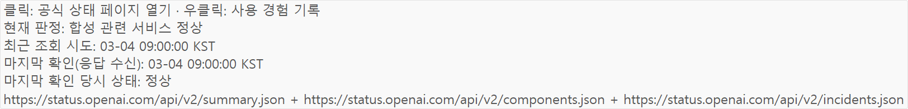
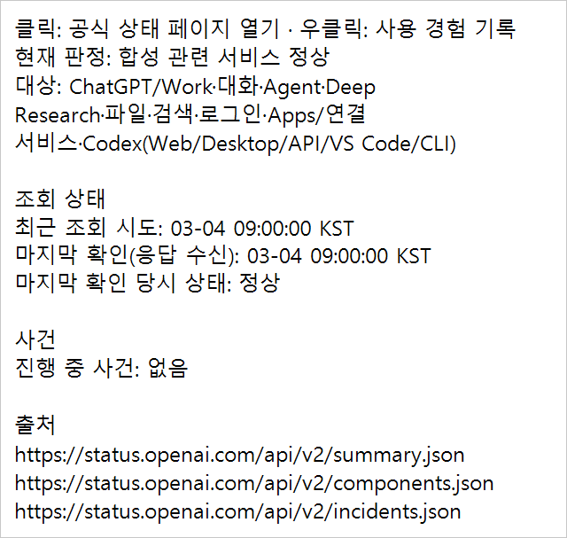
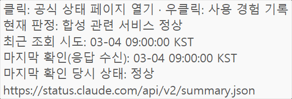
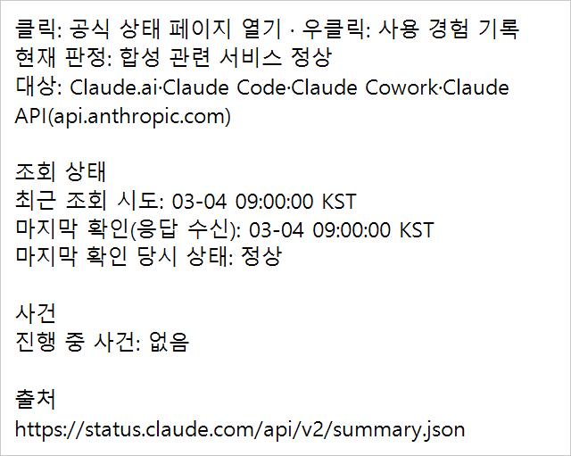
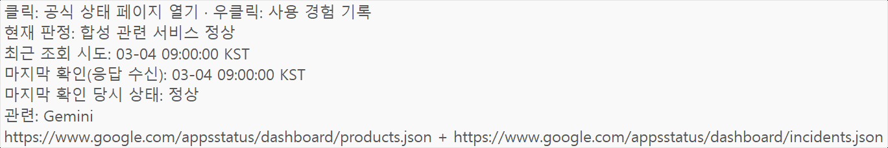
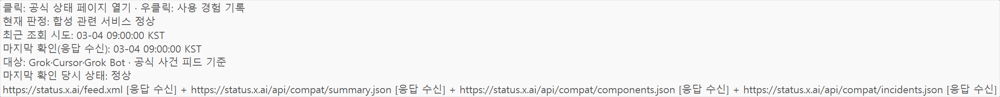
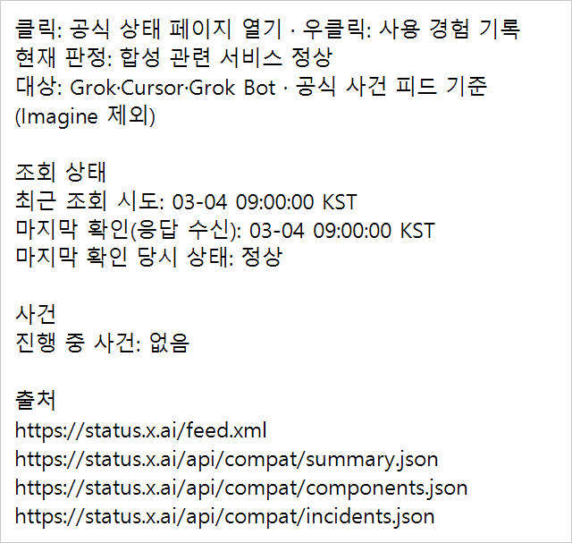

# 네 Provider 상태 상세 · 전후 합성 캡처

모든 상태·사유·사건·시각은 가짜 시각 `2032-03-04T00:00:00Z`의 합성 데이터입니다. 실제 계정 화면·값·인증 정보는 사용하지 않았습니다. 아래 이미지는 실제 Windows 192 DPI(200%) 렌더링입니다.

## 전후 화면

| Provider | 변경 전 기본 ToolTip | 변경 후 고정 폭 상세 |
|---|---|---|
| ChatGPT |  |  |
| Claude |  |  |
| Gemini |  |  |
| xAI |  |  |

변경 전 제품 코드는 `be58d8d0af10f8ca552cb4dad3550fd95eebc270`입니다. 합성 상태 fixture·캡처 검사만 추가한 빌드에서 현재 시험 프로세스가 소유한 기본 ToolTip을 확인·캡처했습니다. 이 임시 캡처 도우미는 제품 코드에 포함하지 않습니다. 변경 후 검증 코드 커밋은 `9c4e5465efa5f1b97188e4ddcf824f7a1123aa6f`이며 이후 커밋은 문서·합성 이미지입니다.

## 폭·높이 측정

| Provider (정상 합성 상태) | 전 폭×높이(px) | 후 폭×높이(px) |
|---|---:|---:|
| ChatGPT | 1,624×197 | 640×607 |
| Claude | 580×197 | 640×511 |
| Gemini | 1,369×229 | 640×639 |
| xAI | 2,337×229 | 640×607 |

- 네 Provider × 정상/진행 사건/범위 미확인/조회 실패 16상태의 변경 후 실제 팝업 외곽 폭은 모두 640px = 320 DIP입니다. 높이는 내용에 따르며 긴 내용에는 세로 스크롤이 생깁니다. 작업 영역이 320 DIP보다 좁으면 기존 화면 내 축소 규칙을 따릅니다.
- 변경 전은 긴 출처 URL 한 줄에 맞춰 기본 ToolTip 폭이 자동으로 늘어납니다. xAI의 URL 4개가 특히 넓었습니다. 변경 후에는 URL별 논리 줄을 나누고 폭 안에서 자동 줄바꿈합니다.
- 상태·한도 팝업의 공용 렌더러는 공백 단위 줄바꿈을 우선하고 긴 URL/단어만 Unicode 문자 요소 단위로 나눕니다. 96/144/192 DPI의 줄바꿈은 오프스크린 측정으로 확인했으며 실제 데스크톱 캡처는 192 DPI입니다.
- 카드 본문·색·클릭/우클릭·판정·알림은 유지합니다. 기존 상태 화면과 한도 화면 PNG 두 개는 전후 파일 해시가 같습니다.

## 최종 검사 결과

| 검사 | 결과 |
|---|---|
| 변경 전 제품 코드 + 새 상세 골든 | `OpenAI/normal exact synthetic detail` 예상 실패 재현 |
| 새 상태 상세 공통 검사 | 71건 통과, 16상태 전체 문구/순서·Detail 외 카드 필드 불변·빈 값·부분 실패·과거 해제 포함 |
| 기존 한도 상세 공통 검사 | 72건 통과 |
| 집중 모델 검사 | PanelModelTests 327건 + 상태 상세 71건 통과 |
| 공백/긴 URL/이모지·결합문자 줄바꿈 | Windows 8건 통과 |
| `build.ps1`, SDK 10.0.403 | 경고 0·오류 0, 종료 코드 0 |
| Windows `--self-test` | 293,027건, 종료 코드 0 |
| Shared.Tests | 291,898건, 종료 코드 0; 기존 권한 제한 symlink fixture 1건 제외 |
| 상태 상세 before / after 고정 슬롯 smoke | 1,092건·57 PNG / 1,141건·58 PNG, 모두 종료 코드 0 |
| 기본 상태/한도 화면 PNG | `full-throttle.png`, `account-quotas.png` 전후 파일 해시 동일 |

호버 지연·16상태 고정 폭·열린 상세 갱신·긴 내용 스크롤/접근성·팝업까지의 포인터 이동·이탈 유예·25초 수명·재등장 차단/재진입·클릭/기록 이벤트·Escape 통과/Alt+Escape 보존·한도 모드 전환·창 숨김/Dispose 정리를 검사했습니다. 25초 수명 검사는 실제 타이머 간격과 합성 Tick을 확인했으며 실제 25초 대기를 반복한 검사는 아닙니다. 스크롤 위치/끝줄·스크롤바 클릭 통과는 확인했으나 실제 마우스 휠 입력을 주입하지는 않았습니다.

가짜 HTTP·CLI·자격 증명·브라우저·알림 발송기만 사용했습니다. 실제 OS 알림 제출·운영 등록·사이트 송신은 0회입니다. 트레이 기록의 반복 실행 증가 검사는 단일 실행이므로 평가하지 않았습니다.

로컬 검증 기록은 `artifacts/status-tooltip-layout/`, 변경 전 기준·red/green 집중 검사는 저장소 밖 임시 `diagnostics/status-tooltip-template-20261109/`에 보관합니다. 실제 계정 자료는 없습니다.

## 미확인·담당 범위

- Mac 공통 검사·임시 빌드·native smoke, 같은 문구/고정 폭·긴 상세/VoiceOver는 Mac 담당 확인 전입니다. Mac 파일은 수정하지 않았습니다.
- 모바일 사이트에는 공식 상태 카드의 HTML `title` 상세가 있어 같은 문구 포트가 필요합니다. 현재 사이트는 변경·배포하지 않았습니다. 모바일 상세를 별도 UI로 제공할지는 메인 결정입니다.
- 버전·배포 EXE·운영 등록은 그대로이며 다음 버전과 함께 배포합니다. 실제 운영 앱은 사용자가 Codex 밖에서 실행합니다.

[공통 상세 틀·판정 범위·출처 표기 근거](../../../STATUS_PROVIDER_DETAILS.md) · [같은 PR의 한도 상세](../quota-provider-detail-20261109/README.md)
