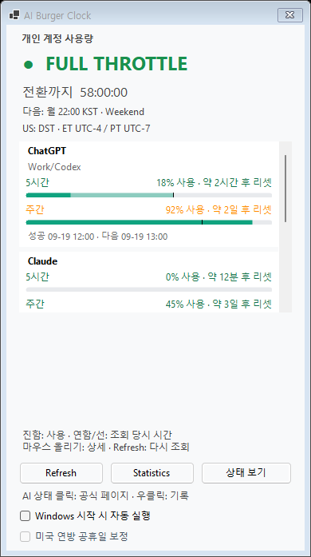
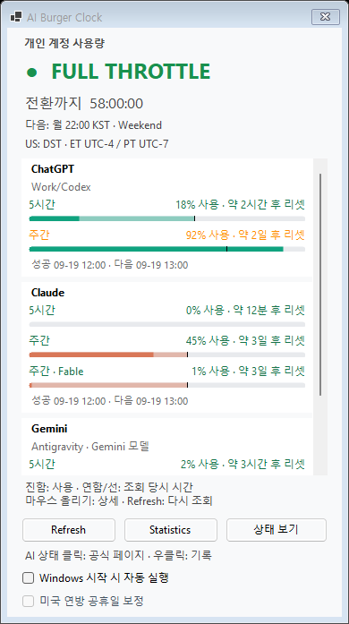
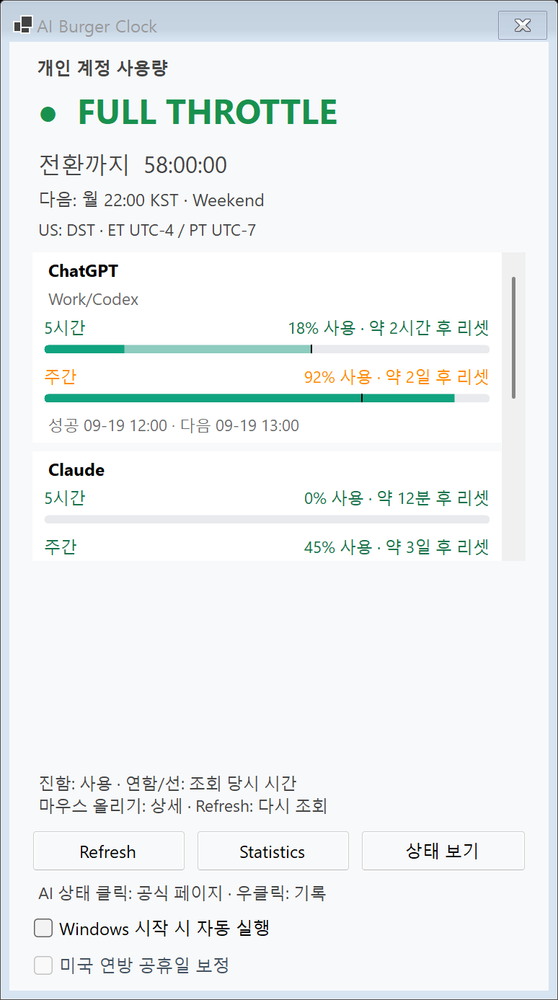
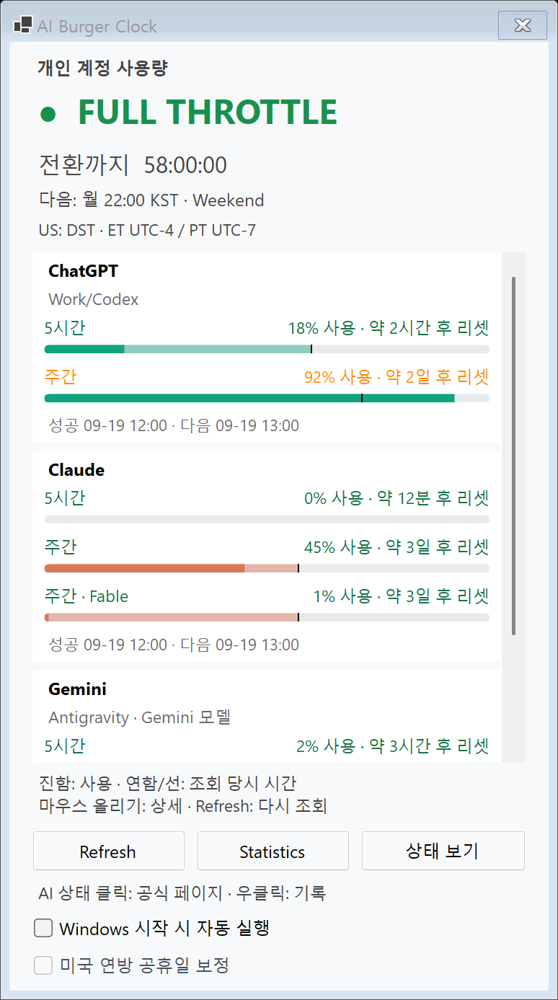
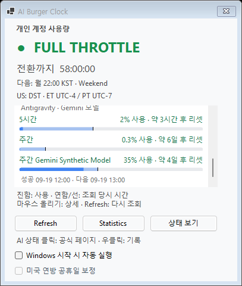
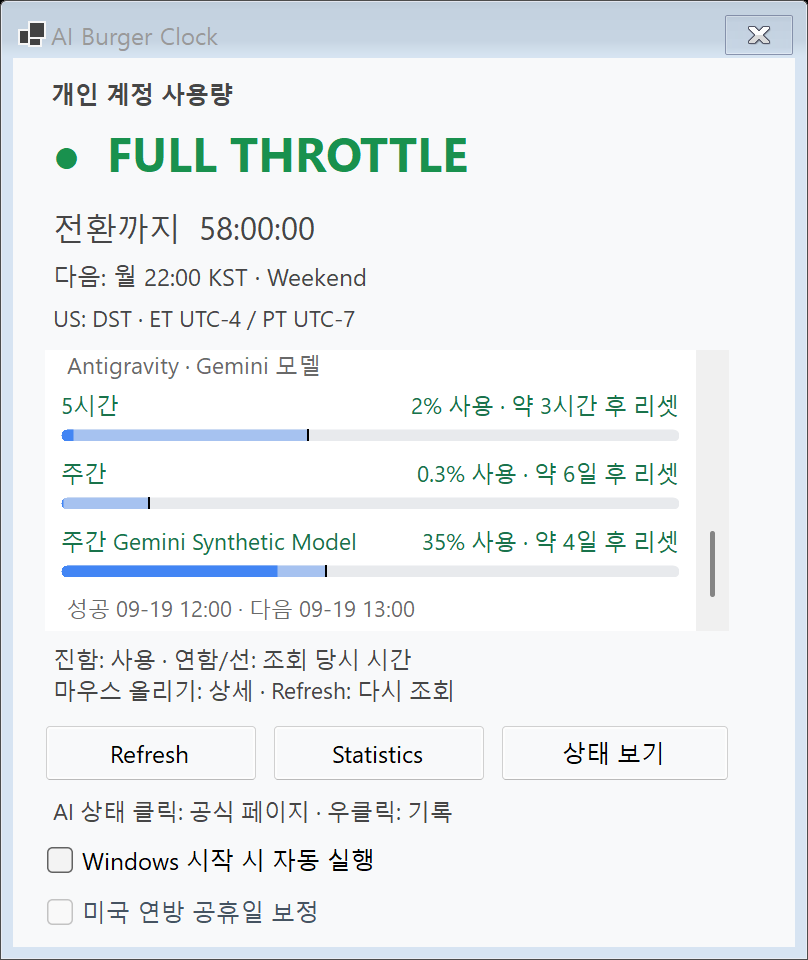

# Windows 한도 영역 높이 회귀 수정

범위: **Windows UI만 변경**. 버전 2.8.4, 공통 원본·Mac·문구·조회/알림 정책·배포 EXE·운영 등록은 그대로입니다.
이미지의 계정 값·모델명·시각은 모두 **합성 데이터**입니다. 실제 계정/DB/CLI를 조회하지 않았습니다.

## 원인과 수정

상태 Provider 카드가 네 개로 늘 때 창과 하단 컨트롤은 89 DIP 내려갔지만 `AccountQuotaView`는 214 DIP 높이를 유지했습니다.
큰 작업 영역에서 한도 영역 하단과 안내 문구 사이에 146 DIP가 남았습니다.

- `StatusWindow.FitWorkArea`: 한도 모드에서 안내 바로 위 6 DIP를 제외한 높이를 스크롤 영역에 배정합니다. 상태 모드의 기존 전체 스크롤·창 크기 계산은 유지합니다.
- 작은 작업 영역에서는 같은 창 크기 안에서 한도 영역이 줄고 하단 안내·버튼·체크박스를 화면 안으로 올립니다. 상태 모드로 돌아가면 원래 위치를 복원합니다.
- 헤더와 하단 컨트롤조차 함께 들어갈 수 없는 극단적으로 짧은 영역은 기존 전체 창 스크롤을 유지합니다.
- 상태 스크롤 복구 시 숨겨져 있던 한도 영역만 밀리지 않도록 그 시작점을 기존 시간대 줄의 아래 여백에 맞춥니다.
- 카드 크기·카드 사이 6 DIP·행 수·텍스트는 변경하지 않습니다. 내용이 들어가는 두 Provider 화면은 불필요한 내부 스크롤이 없어지므로 관련 기존 검사 기대값을 갱신했습니다.

## 기준 커밋

| 구분 | 커밋 |
|---|---|
| 작업 시작 main (#102 포함) | `a996eefeb5e66fe57f3d7ff94676631a44bf0667` |
| 최초 회귀 smoke 추가 | `8817d6c` |
| 최종 코드·검사 빌드 | `342df9e95a0276c1b66df3809c0ff0e72b4dfa83` |

수정 전 비교 payload는 위 main의 원본 `StatusWindow.cs`에 같은 합성 viewport 검사를 추가한 사본입니다. 배포본과 main의 `StatusWindow.cs`가 같은 것도 대조했습니다. 검증용 사본은 `artifacts/quota-viewport-before/baseline-source/`이며 운영 EXE를 실행하거나 교체하지 않았습니다.

## DPI와 재현 방식

Windows 설정은 바꾸지 않았습니다. 200% 시스템에서 기본 `SystemAware` 빌드의 실제 `DeviceDpi=192`와, 별도 검사 전용 `-p:ApplicationHighDpiMode=DpiUnaware` 빌드의 실제 `DeviceDpi=96`을 **서로 다른 프로세스**로 확인했습니다. csproj의 기본 DPI 설정은 변경하지 않았습니다. PNG는 해당 WinForms의 `DrawToBitmap` 결과이며 실제 100% 모니터에서 사용자가 조작한 화면 캡처를 뜻하지 않습니다.

고정 `before`/`after` 슬롯을 사용하고, 로그/PNG는 `artifacts/quota-viewport-{96,192}/windows-tests/{before,after}/`에 나누어 보존합니다.

```powershell
.\build.ps1 -ReportGroup quota-viewport-after
dotnet build AiBurgerClock.csproj -c Release --nologo -warnaserror -p:ApplicationHighDpiMode=DpiUnaware -p:OutputPath=artifacts/quota-viewport-after/dpi96/
.\test-windows.ps1 -Slot after -SourceDirectory bin/Release/net10.0-windows10.0.19041.0/win-x64 -SourceCommit 342df9e95a0276c1b66df3809c0ff0e72b4dfa83 -ReportGroup quota-viewport-192 -Repeat 1
.\test-windows.ps1 -Slot after -SourceDirectory artifacts/quota-viewport-after/dpi96 -SourceCommit 342df9e95a0276c1b66df3809c0ff0e72b4dfa83 -ReportGroup quota-viewport-96 -Repeat 1
```

## 최종 결과

SDK 10.0.403, Windows Desktop Runtime 10.0.14. 최초 NuGet audit 통신 실패는 권한을 받은 공식 피드 복원으로 해소했고 audit를 비활성화하지 않았습니다.

| 검증 | 결과 |
|---|---|
| 최종 `build.ps1` | 경고 0 / 오류 0 |
| self-test | **291,779 PASS** (공통 291,074 + Windows 705, 변경 없음) |
| 96 DPI smoke | **927 PASS / 34 PNG / 종료 코드 0** |
| 192 DPI smoke | **927 PASS / 34 PNG / 종료 코드 0** |

| DPI | 작업 영역 | 창 크기 전후(px) | 한도 영역 높이 전 → 후(px) | 안내 앞 여백 전 → 후(px) |
|---|---|---|---|---|
| 96 (100%) | 큰 영역 1280×900 DIP | 390×697 동일 | 214 → 354 | 146 → **6** |
| 96 (100%) | 작은 영역 1280×480 DIP | 407×480 동일 | 214 → 137 | 133 → **6** |
| 192 (200%) | 큰 영역 1280×900 DIP | 774×1387 동일 | 428 → 708 | 292 → **12** |
| 192 (200%) | 작은 영역 1280×480 DIP | 808×960 동일 | 428 → 281 | 273 → **12** |

`comparison.json`에 원본 로그 위치와 수치를 보존했습니다.

- 네 조합 모두 안내 앞 여백 **6 DIP 이하**, 창 크기·세 카드 크기·카드 간격 동일.
- 네 조합의 상태 보기 전후 PNG **RGBA 전체 픽셀 일치**. 한도에서 돌아온 상태 보기 역시 각 최초 상태 PNG와 전체 일치.
- 기존 FULL THROTTLE·BURGER TIME 상태 PNG도 각 DPI에서 전후 전체 픽셀 일치(추가 4쌍).
- 작은 영역에서 세 Provider의 마지막 Gemini 행/메타데이터까지 내부 스크롤로 접근, 가로 스크롤 없음, 하단 컨트롤 모두 client 안에 포함.
- 작은 영역→큰 영역→작은 영역 복구 및 상태 모드 복귀 검사 통과.
- 합성 HTTP·세 Provider quota fixture와 임시 DB, 가짜 풍선/토스트 전송만 사용. 실제 OS 알림 0.
- 각 최종 실행은 Repeat=1이므로 트레이 기록 반복 증가 검증은 `NotEvaluated`입니다. 관측된 신규 키는 각각 0입니다.

## 전후 이미지

### 100% 큰 작업 영역

| 이전 | 수정 후 |
|---|---|
|  |  |

### 200% 큰 작업 영역

| 이전 | 수정 후 |
|---|---|
|  |  |

### 작은 작업 영역의 마지막 행과 하단 컨트롤

| 100% | 200% |
|---|---|
|  |  |

작은 영역 전후 및 상태 보기는 `images/`의 나머지 PNG로 함께 보존했습니다.

## 중간 재현과 미확인

수정 전 두 DPI 모두 새 여백/하단 접근 검사가 실패하여 문제를 재현했습니다. 중간 검증에서 두 Provider의 기존 강제 스크롤 기대값과, 작은 상태 창에서 숨겨진 한도 영역의 위치 이동을 추가로 잡아 수정했습니다. 최초 스레드 DPI 전환 실험은 실제 96 DPI를 유지하지 못해 최종 100% 증거에서 제외하고 별도 프로세스 방식으로 대체했습니다. 이 실패 로그는 `artifacts/quota-viewport*/`에 남아 있습니다.

운영 EXE SHA-256은 `1A708ACBCC231F7D12DBC659F001EEC189E20F6667AE5D149D6C4D189147AF3C`로 교체 전후 동일합니다. 운영 앱은 사용자가 외부에서 종료하고 검사 후 같은 배포본을 외부에서 다시 실행했다고 확인했습니다. Codex가 운영 앱·등록을 실행하지 않았습니다.

실제 사용자 포인터로 스크롤/키보드 조작, 물리적으로 다른 배율의 복수 모니터 이동, 운영 배포는 미수행입니다. Mac·공통 코드는 바꾸지 않았고 버전도 올리지 않았습니다. 병합·배포는 사용자가 결정합니다.
