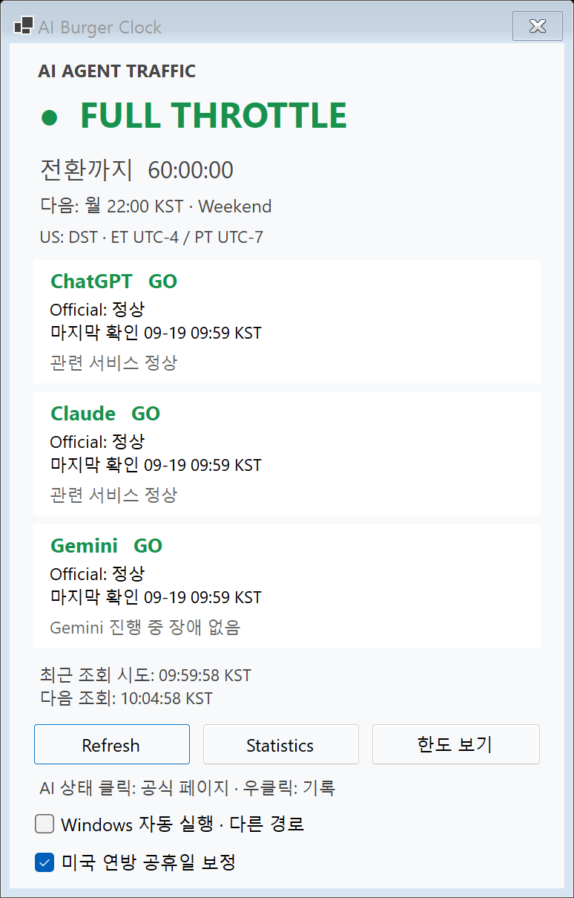
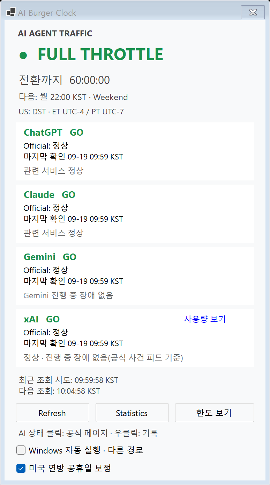
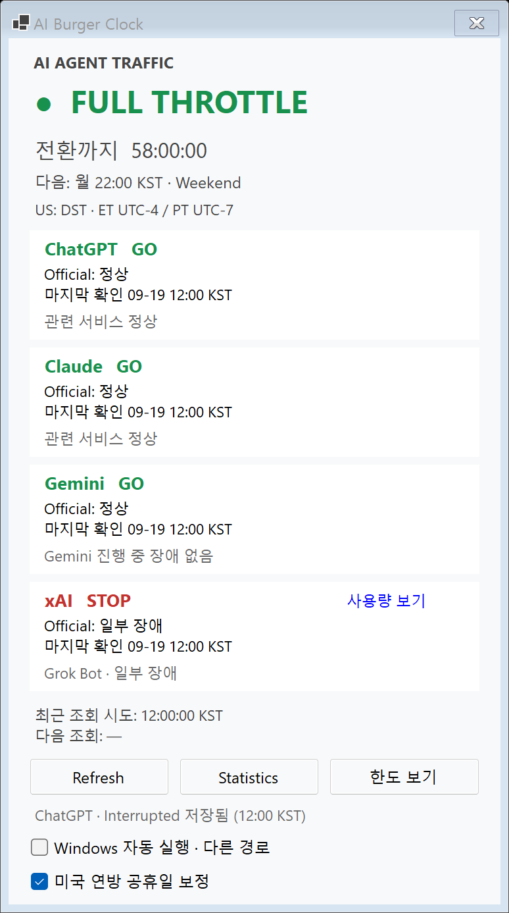
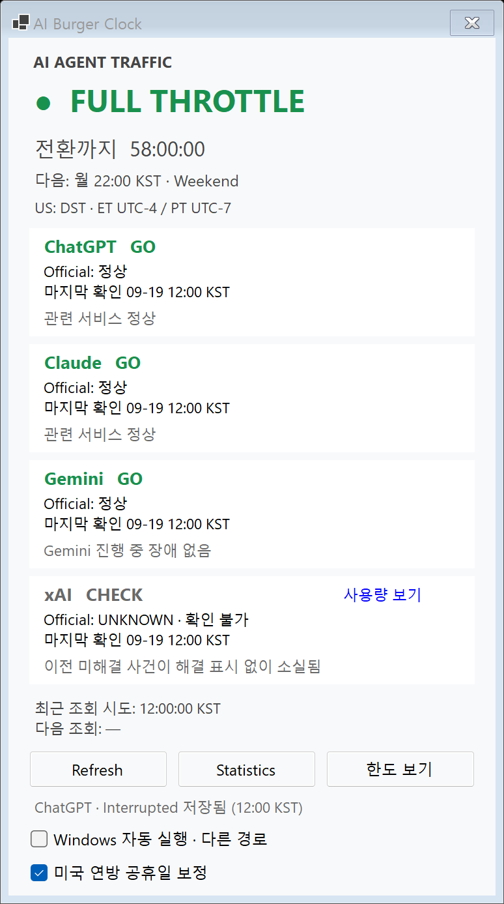
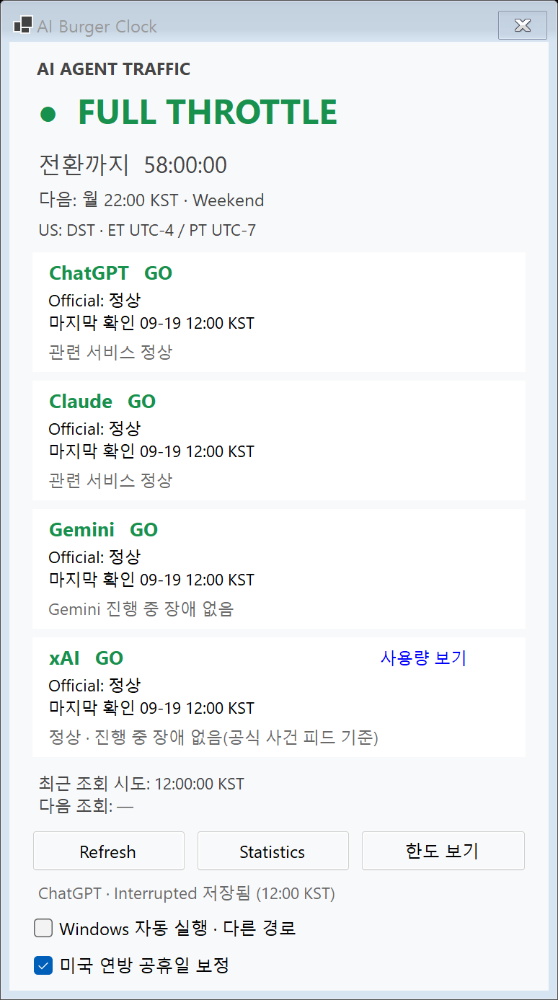
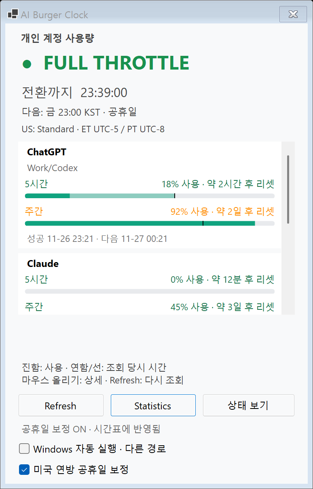
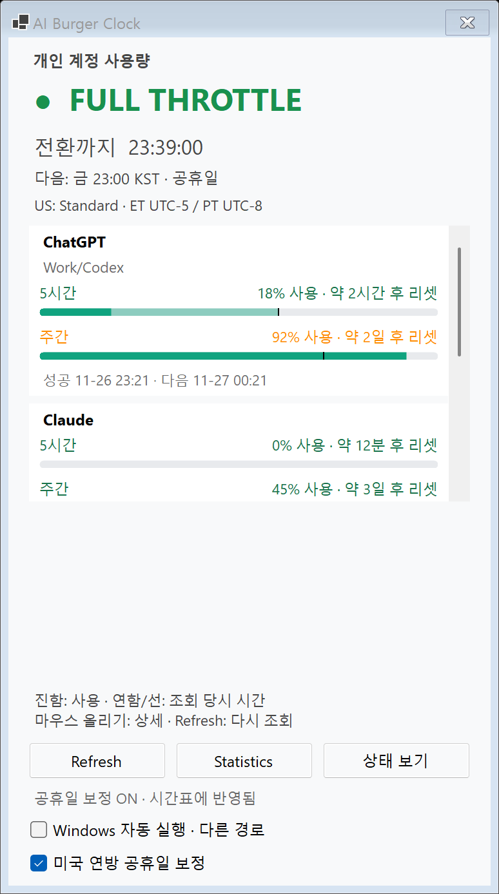

# xAI 상태 카드 전후 이미지 (합성 데이터)

실제 계정 값이나 실제 계정 화면은 포함하지 않습니다.
기준은 main `0ccd96fb1f388dbbc11be91a595344177f025350`, 변경 후 검사 코드는
`1787bb2d793badeaa464639159fd542371376df6`입니다.

## 상태 화면

| 변경 전 | 변경 후 |
|---|---|
|  |  |

기본 client 크기는 374×569→374×658 DIP입니다. 실제 200% DPI 캡처에서는
774×1209→774×1387 px입니다. 기존 세 카드 영역은 동일하고 네 번째 xAI 카드와
`사용량 보기` 링크를 추가했습니다. 하단 컨트롤은 89 DIP 내렸으며 Refresh 포커스 테두리 차이가 있습니다.
작은 작업 영역에서는 창 높이를 맞추고 본문을 스크롤합니다.

## 진행 사건 · 해결 없이 소실 · 명시적 해결

| 합성 진행 사건 | 해결 없이 소실 | 명시적 해결 |
|---|---|---|
|  |  |  |

확인된 진행 사건은 STOP, 해결 확인 없이 사라진 사건은 CHECK로 남습니다.
해결 표시를 수신한 뒤에만 정상으로 돌아가 정상화 오알림을 막습니다.

## 기존 한도 화면

| 변경 전 | 변경 후 |
|---|---|
|  |  |

한도 박스의 행·막대·스크롤 영역은 유지합니다. 상태 화면과 같은 창을 쓰므로 바깥 창 높이와
하단 컨트롤 위치는 달라집니다. xAI 한도 박스나 수치는 추가하지 않습니다.
계측 대화상자와 한도 Provider 상세 네 PNG는 전후 픽셀 단위로 동일했습니다.
